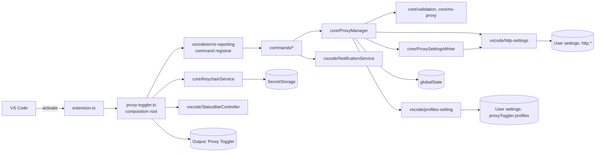

# Architecture

Short notes for contributors. The code is meant to explain itself; this file records what the code
cannot: the layer rules, the data the extension persists, the error model, and the reasons behind
a few design choices.

## Layers

```text
src/
  extension.ts      VS Code entry point. The only module that loads `vscode` at runtime.
  proxy-toggler.ts  Composition root: creates every object, registers commands, starts activation checks.
  core/             Domain logic: configuration types, validation, bypass-list rules, the Match
                    rule (when VS Code's settings carry a profile's values), profiles (reading
                    the setting, the current profile), ProxyManager (the record, the toggle),
                    ProxySettingsWriter (writing and clearing the http.* settings),
                    KeychainService (removing the credentials 0.1.x stored).
  commands/         One file per command or flow (enable, disable, toggle, the switcher, add,
                    edit and delete), the activation-time checks, and the shared feedback.
  vscode/           Adapters over the VS Code API: the API surface type, the http.* and profiles
                    setting adapters, notifications, the status bar item, and error reporting.
```

Two dependency rules are enforced by ESLint (`eslint.config.mjs`):

1. Only `src/extension.ts` imports `vscode` at runtime. Every other module imports VS Code _types_
   at most and receives the API it needs as a parameter.
2. `src/core` imports nothing from `src/commands`, `src/vscode`, or the composition root.

Dependencies are wired by hand in `src/proxy-toggler.ts` with explicit constructor and function
parameters. There is no IoC container.



## How a command runs

1. VS Code activates the extension the first time one of its commands runs (no explicit
   activation events are needed since VS Code 1.74).
2. The registrar in `vscode/error-reporting.ts` calls the command. Commands show the errors they
   can explain; any other error is logged to the **Proxy Toggler** output channel and shown with
   the command's failure message.
3. Commands call `ProxyManager`, which validates input, saves profiles in the
   `proxyToggler.profiles` setting, keeps the record in `globalState`, and writes or clears the
   three `http.*` user settings through
   `ProxySettingsWriter` and the settings adapter.
4. `refreshUi` updates the status bar and the `setContext` keys that decide which commands the
   Command Palette shows.

At activation these background tasks run, and their failures are logged:

- a UI refresh;
- the removal of the credentials 0.1.x stored. When it found a secret, a one-time notice appears
  in the next focused window of that VS Code Profile;
- the migration of the 0.1.x configuration into a profile (ADR 0001), then reconciliation (below),
  then a drift check that offers to sync the stored toggle state when VS Code's `http.*` settings
  no longer match it;
- once `proxyToggler.profiles` has stayed unchanged for two seconds, a second migration pass. It
  records the copy when the list still shows it, or makes the copy again when a VS Code Profile
  migrating at the same time overwrote the list.

## Keeping windows in step

Every window keeps the record of the settings it manages in step with them: at activation, when
`http.*` or `proxyToggler.profiles` changes and the settings have then stayed unchanged for two
seconds, and when the window gains focus. `ProxyManager.reconcile` turns the record off when the
settings are cleared, and makes the profile they match current and on, the current profile
winning a tie. A proxy that matches no profile is drift and leaves the record alone.

Only the focused window acts on an outside change: it re-applies an outside edit to the
remembered current profile, while on and while the settings still hold its old values; a window
without focus leaves that to the next window to gain it (ADR 0004). VS Code fires the change event
before `update()` resolves, so `ProxyManager` marks its own writes while they are under way, and a
window treats the events they cause as done.

## Ports

Core classes depend on small structural types rather than on VS Code objects:

| Consumer              | Port              | Real implementation                              |
| --------------------- | ----------------- | ------------------------------------------------ |
| `ProxyManager`        | `Memento`         | `readYourWrites(context.globalState)`            |
| `ProxyManager`        | `HttpSettings`    | `createHttpSettings(vscode)`, read only          |
| `ProxyManager`        | `ProfilesSetting` | `createProfilesSetting(vscode)`                  |
| `ProxySettingsWriter` | `HttpSettings`    | `createHttpSettings(vscode)`                     |
| `KeychainService`     | `SecretStorage`   | `context.secrets`                                |
| Commands, UI          | `VscodeApi` slice | the `vscode` module, passed in by `extension.ts` |

`VscodeApi` (`src/vscode/api.ts`) is declared once and typed against `@types/vscode`, which is
pinned to the minimum supported VS Code release. Because `extension.ts` passes the real module
without a cast, the compiler checks that the declared slice matches VS Code.

## Persisted data

These keys and shapes are a compatibility contract with installed copies of the extension. Unit
tests pin them.

| Store           | Key                                                                      | Shape                                                                                            |
| --------------- | ------------------------------------------------------------------------ | ------------------------------------------------------------------------------------------------ |
| User settings   | `proxyToggler.profiles` (application scope)                              | `[{ name, proxyUrl, strictSSL, bypassList }]`; saves keep other entries and unknown fields       |
| `globalState`   | `proxyToggler.savedProxy`                                                | 0.1.x's `{ proxyUrl, strictSSL, noProxy }`; v0.2.0 never writes it (ADR 0001)                    |
| `globalState`   | `proxyToggler.migratedProxy`                                             | the `savedProxy` values whose copy a later read showed, as `{ proxyUrl, strictSSL, bypassList }` |
| `globalState`   | `proxyToggler.state`                                                     | the record: `{ isEnabled, hasConfiguration, currentProfile }`; other fields are kept             |
| `globalState`   | `proxyToggler.hiddenProfilesWarned`                                      | a SHA-256 hash of the hidden entries last warned about; never the entries themselves             |
| `SecretStorage` | `proxyToggler.credentials.username`, `proxyToggler.credentials.password` | trimmed strings; no version applied them, and every activation deletes them (ADR 0003)           |
| `globalState`   | `proxyToggler.credentialsNoticePending`                                  | `true` from a removal that found a secret until the notice shows                                 |
| `globalState`   | `proxyToggler.credentialsRemovalNoticeShown`                             | `true` once the notice about removing the credentials in `http.proxy` has shown                  |
| User settings   | `http.proxy`, `http.proxyStrictSSL`, `http.noProxy` (array)              | written on enable, removed on disable                                                            |
| Context keys    | `proxyToggler.hasConfiguration`, `proxyToggler.isEnabled`                | booleans used by `contributes.menus.commandPalette`                                              |

Credentials never go to `globalState`, settings, logs, or messages.

## Error model

| Error                | Raised by                               | Shown as                                                    |
| -------------------- | --------------------------------------- | ----------------------------------------------------------- |
| `ValidationError`    | `core/validation.ts`                    | The reason and examples, in the input box or a notification |
| `KeychainError`      | `KeychainService` removing old secrets  | Logged; the removal is retried at the next activation       |
| `ConfigurationError` | `ProxySettingsWriter` writing a setting | `toUserMessage()` with an **Open Settings** action          |
| Anything else        | Anywhere                                | Logged with its stack; the command's failure message        |

Errors carry the original failure as the standard ES2022 `cause`.

### Failed setting writes

- Enabling writes `http.proxy`, `http.proxyStrictSSL`, and `http.noProxy` in that order, and
  records `isEnabled` only after all three succeed.
- If a write fails, `ProxySettingsWriter` writes the earlier user-settings values back to the
  settings it already changed, then throws the `ConfigurationError` for the setting that failed. It
  reads the earlier values with `inspect().globalValue`, not `get()`: `get()` returns defaults and
  workspace values, and writing those back would copy them into user settings.
- If writing an earlier value back fails too, `ProxySettingsWriter` still restores the other
  settings and still throws the same `ConfigurationError`, because the setting that failed first is
  the one the user can act on. The error's `restoreErrors` holds each setting it could not restore,
  with the error that write raised, and its message names those settings.
- Disabling has no rollback. It clears `http.proxy` first, so a partial disable leaves the proxy
  off while the stored state still says enabled; the drift check offers to sync at the next
  activation.

## Design decisions

- **VS Code-shaped ports instead of custom wrappers.** The configure wizard calls `showInputBox`
  and `showQuickPick` through the injected `VscodeApi` slice. Wrapping each prompt behind an
  application-specific interface would add a parallel API without adding any guarantee.
- **Minimum VS Code 1.97.** `http.noProxy` first shipped in 1.91; on older releases enabling the
  proxy cannot complete. On 1.91 the VS Code window ignores an `http.proxy` that holds
  `user:pass@`, and extensions get no sign-in dialog for a Basic-auth proxy before 1.92. Remote
  windows need `http.useLocalProxyConfiguration`, new in 1.97, which says whether a WSL or container
  window's remote side uses the local proxy settings or its own. The sources are in
  [the v0.2.0 research](docs/design/v0.2.0-research.md), findings A3 and B3 and the remote-window
  section.
- **Supported in Restricted Mode and virtual workspaces.** The extension reads no workspace files
  and writes only user settings, `globalState`, and SecretStorage, so the manifest declares
  `untrustedWorkspaces.supported: true` and `virtualWorkspaces: true`. In Restricted Mode VS Code
  ignores workspace values of the `http.*` settings, which it marks restricted, so a workspace can
  change only `proxyToggler.confirmBeforeToggle`, which adds or removes a confirmation prompt.
  Without the declaration, VS Code disables the extension in every untrusted folder.
- **Bypass list stored as a string.** The stored shape predates VS Code's array setting and is kept
  for compatibility; it is converted to an array when written.
- **State changes run one at a time.** VS Code runs commands concurrently, and a double click on
  the status bar item starts two toggles. `ProxyManager` queues every change of the profiles, the
  record and the `http.*` settings: each starts after the previous one settles, whether it
  succeeded or failed, and reads the state it left. Commands wait for the user before or after
  calling `ProxyManager`, never inside a queued change, so the extension's own prompts never hold
  up the queue.
- **Reads see the extension's own writes.** VS Code sends every change of an extension's
  `globalState` back to the extension host (`MainThreadStorage` calls `$acceptValue`), and the host
  replaces its in-memory value with it. The echo of an earlier write can arrive after a newer
  write, so `get` can briefly return the older value, and nothing refreshes the status bar when the
  correct value returns. On a macOS CI runner, 13 of 1,800 status checks after back-to-back
  `disable` and `enable` commands showed the previous state, on VS Code 1.91.0 and 1.142.0, and 3
  of them still did 500 ms later. `readYourWrites` wraps the `Memento` port and serves a written
  value from memory for five seconds. After that the host's value wins, so a change made by another
  window is still seen.
- **Lazy activation.** Only commands activate the extension, so the status bar item appears after
  the first command in a session.
- **No stored credentials.** Profiles hold no credentials, and the extension never sets
  `http.proxyAuthorization`; VS Code's login dialog answers a proxy's sign-in request (ADR 0003).
- **Bundled output.** esbuild produces `dist/extension.js`, the only code that ships. `out/` holds
  the `tsc` output used to run the integration tests.
