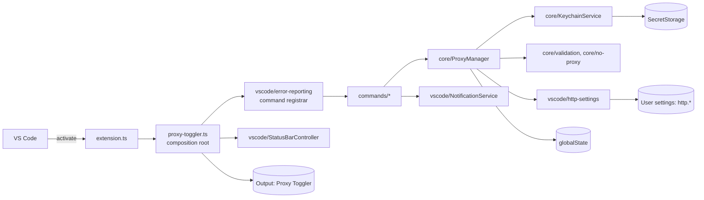

# Architecture

Short notes for contributors. The code is meant to explain itself; this file records what the code
cannot: the layer rules, the data the extension persists, the error model, and the reasons behind
a few design choices.

## Layers

```text
src/
  extension.ts      VS Code entry point. The only module that loads `vscode` at runtime.
  proxy-toggler.ts  Composition root: creates every object, registers commands, starts activation checks.
  core/             Domain logic: configuration types, validation, bypass-list rules, ProxyManager
                    (saved configuration, toggle state, applying settings), KeychainService (credentials).
  commands/         One file per command (configure, enable, disable, toggle), the activation-time
                    drift check, and the feedback shared by the state commands.
  vscode/           Adapters over the VS Code API: the API surface type, the http.* settings adapter,
                    notifications, the status bar item, and error reporting.
```

Two dependency rules are enforced by ESLint (`eslint.config.mjs`):

1. Only `src/extension.ts` imports `vscode` at runtime. Every other module imports VS Code _types_
   at most and receives the API it needs as a parameter.
2. `src/core` imports nothing from `src/commands`, `src/vscode`, or the composition root.

Dependencies are wired by hand in `src/proxy-toggler.ts` with explicit constructor and function
parameters. There is no IoC container.



## How a command runs

1. VS Code activates the extension the first time one of its commands runs (no explicit
   activation events are needed since VS Code 1.74).
2. The registrar in `vscode/error-reporting.ts` calls the command. Commands show the errors they
   can explain; any other error is logged to the **Proxy Toggler** output channel and shown with
   the command's failure message.
3. Commands call `ProxyManager`, which validates input, persists the configuration in
   `globalState`, stores credentials through `KeychainService`, and writes or clears the three
   `http.*` user settings through the settings adapter.
4. `refreshUi` updates the status bar and the `setContext` keys that decide which commands the
   Command Palette shows.

At activation two background tasks run: a UI refresh and a drift check that offers to sync the
stored toggle state when VS Code's `http.*` settings no longer match it. Their failures are logged.

## Ports

Core classes depend on small structural types rather than on VS Code objects:

| Consumer          | Port              | Real implementation                              |
| ----------------- | ----------------- | ------------------------------------------------ |
| `ProxyManager`    | `Memento`         | `context.globalState`                            |
| `ProxyManager`    | `CredentialStore` | `KeychainService`                                |
| `ProxyManager`    | `HttpSettings`    | `createHttpSettings(vscode)`                     |
| `KeychainService` | `SecretStorage`   | `context.secrets`                                |
| Commands, UI      | `VscodeApi` slice | the `vscode` module, passed in by `extension.ts` |

`VscodeApi` (`src/vscode/api.ts`) is declared once and typed against `@types/vscode`, which is
pinned to the minimum supported VS Code release. Because `extension.ts` passes the real module
without a cast, the compiler checks that the declared slice matches VS Code.

## Persisted data

These keys and shapes are a compatibility contract with installed copies of the extension. Unit
tests pin them.

| Store           | Key                                                                      | Shape                                                                                              |
| --------------- | ------------------------------------------------------------------------ | -------------------------------------------------------------------------------------------------- |
| `globalState`   | `proxyToggler.savedProxy`                                                | `{ proxyUrl, strictSSL, noProxy }`; `noProxy` is a comma-separated string                          |
| `globalState`   | `proxyToggler.state`                                                     | `{ isEnabled, hasConfiguration }`; `hasConfiguration` is recomputed on read, other fields are kept |
| `SecretStorage` | `proxyToggler.credentials.username`, `proxyToggler.credentials.password` | trimmed strings                                                                                    |
| User settings   | `http.proxy`, `http.proxyStrictSSL`, `http.noProxy` (array)              | written on enable, removed on disable                                                              |
| Context keys    | `proxyToggler.hasConfiguration`, `proxyToggler.isEnabled`                | booleans used by `contributes.menus.commandPalette`                                                |

Credentials never go to `globalState`, settings, logs, or messages.

## Error model

| Error                | Raised by                        | Shown as                                                    |
| -------------------- | -------------------------------- | ----------------------------------------------------------- |
| `ValidationError`    | `core/validation.ts`             | The reason and examples, in the input box or a notification |
| `KeychainError`      | `KeychainService`                | `toUserMessage()`; the reason is inferred from the message  |
| `ConfigurationError` | `ProxyManager` writing a setting | `toUserMessage()` with an **Open Settings** action          |
| Anything else        | Anywhere                         | Logged with its stack; the command's failure message        |

Errors carry the original failure as the standard ES2022 `cause`.

### Failed setting writes

- Enabling writes `http.proxy`, `http.proxyStrictSSL`, and `http.noProxy` in that order, and
  records `isEnabled` only after all three succeed.
- If a write fails, `ProxyManager` writes the earlier user-settings values back to the settings it
  already changed, then throws the `ConfigurationError` for the setting that failed. It reads the
  earlier values with `inspect().globalValue`, not `get()`: `get()` returns defaults and
  workspace values, and writing those back would copy them into user settings.
- If writing an earlier value back fails too, `ProxyManager` still restores the other settings and
  still throws the same `ConfigurationError`, because the setting that failed first is the one the
  user can act on. The error's `restoreErrors` holds each setting it could not restore, with the
  error that write raised, and its message names those settings.
- Disabling has no rollback. It clears `http.proxy` first, so a partial disable leaves the proxy
  off while the stored state still says enabled; the drift check offers to sync at the next
  activation.

## Design decisions

- **VS Code-shaped ports instead of custom wrappers.** The configure wizard calls `showInputBox`
  and `showQuickPick` through the injected `VscodeApi` slice. Wrapping each prompt behind an
  application-specific interface would add a parallel API without adding any guarantee.
- **Minimum VS Code 1.91.** `http.noProxy` first shipped in 1.91; on older releases enabling the
  proxy cannot complete.
- **Bypass list stored as a string.** The stored shape predates VS Code's array setting and is kept
  for compatibility; it is converted to an array when written.
- **State changes run one at a time.** VS Code runs commands concurrently, and a double click on
  the status bar item starts two toggles. `ProxyManager` queues `saveConfiguration`,
  `enableProxy`, `disableProxy`, `toggleProxy`, and `syncToggleState`: each starts after the
  previous one settles, whether it succeeded or failed, and reads the state it left. Commands wait
  for the user before or after calling `ProxyManager`, never inside a queued change, so the
  extension's own prompts never hold up the queue. The one wait it does not control is SecretStorage
  inside `saveConfiguration`: while the operating system's keychain prompt for storing credentials
  is open, toggles wait behind it.
- **Lazy activation.** Only commands activate the extension, so the status bar item appears after
  the first command in a session.
- **Credentials are stored but not applied.** The extension keeps credentials in the OS keychain
  and offers to keep, replace, or remove them, but does not set `http.proxyAuthorization`.
- **Bundled output.** esbuild produces `dist/extension.js`, the only code that ships. `out/` holds
  the `tsc` output used to run the integration tests.
