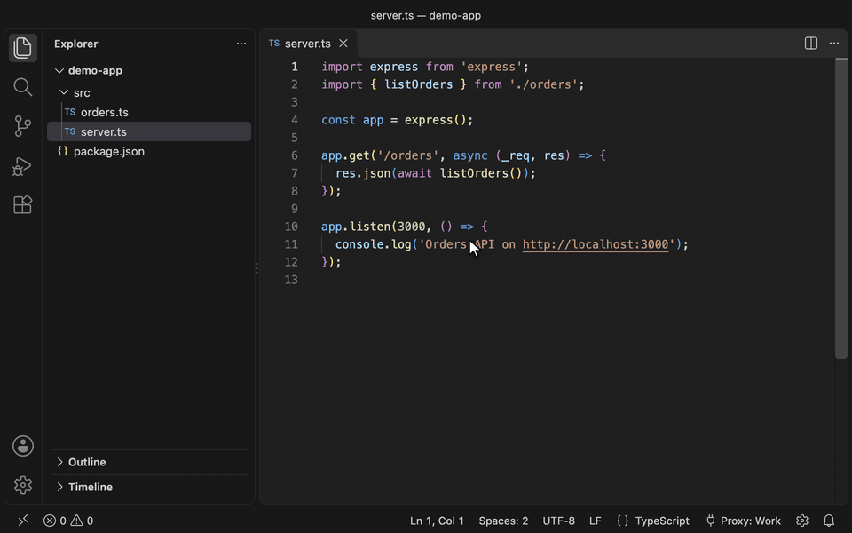
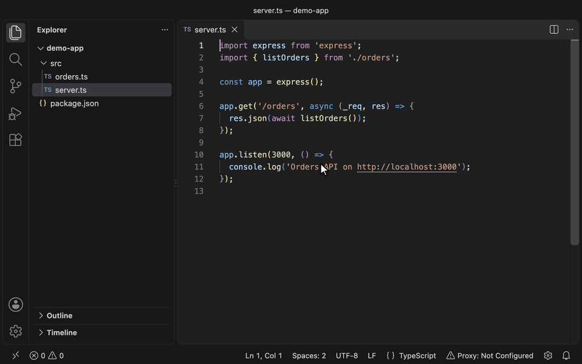
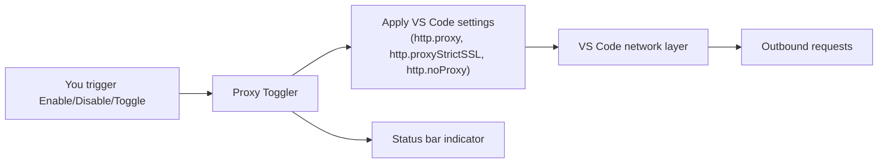

# Proxy Toggler

<p align="center">
  <a href="https://github.com/bluecloud-dev/proxy-toggler/actions/workflows/ci.yml">
    
  </a>
  <a href="https://github.com/bluecloud-dev/proxy-toggler/releases">
    
  </a>
  <a href="LICENSE">
    
  </a>
</p>

<p align="center">
  
</p>

<p align="center">
  Switch VS Code's HTTP proxy between proxy profiles and off, from the status bar.
</p>

<!-- Marketplace badges will go here once published -->

---

## Table of Contents

- [Features](#star-features)
- [Requirements](#clipboard-requirements)
- [Quick Start](#zap-quick-start)
- [Commands](#keyboard-commands)
- [Keybindings](#keyboard-keybindings)
- [Settings](#gear-settings)
- [How VS Code Uses Proxy Settings](#globe_with_meridians-how-vs-code-uses-proxy-settings)
- [How It Works](#bulb-how-it-works)
- [Security](#lock-security)
- [Troubleshooting](#wrench-troubleshooting)
- [Contributing](#handshake-contributing)
- [License](#page_facing_up-license)

## :star: Features

- **Proxy profiles**: keep several proxies and switch between them from the status bar gear
- **One-click toggle** from the Command Palette or status bar
- **Test Connection** checks a profile's proxy against a URL you pick, and says which side of VS
  Code reaches it directly. For HTTPS it tests the origin's root, not the URL's path. The URL
  cannot contain credentials, and the result does not show its path or query.
- **No stored credentials**: when a proxy asks for a sign-in, VS Code shows its own login dialog
- **Visual status indicator** showing on or off and the current profile
- **Optional confirmation prompt** before toggling
- **Strict SSL and no-proxy list** support
- **Remote windows**: in SSH, Tunnels and remote container windows, the toggle manages the remote
  machine's own proxy settings and leaves local windows alone
- **Project defaults**: a project's settings name the profile it uses, or no proxy, and VS Code's
  proxy follows the window you work in
- **Integrated terminals** (opt-in): Git, npm and other command-line tools in VS Code's terminals
  use the same proxy, in every project or only the ones you choose
- **Get Started walkthrough** on VS Code's Welcome page, from your first profile to terminals and
  project defaults
- **Non-invasive** — leaves system proxy configuration untouched

### Switch profiles from the status bar



### Add a profile and test its connection



## :clipboard: Requirements

- VS Code **1.97** or later

## :zap: Quick Start

1. Install from the [VS Code Marketplace](https://marketplace.visualstudio.com/items?itemName=bluecloud-dev.proxy-toggler) or via VSIX:

   ```sh
   code --install-extension proxy-toggler-*.vsix
   ```

   VS Code then opens the **Get Started with Proxy Toggler** walkthrough, which covers these
   steps and more. **Welcome: Open Walkthrough…** opens it again.

2. Open Command Palette (`Cmd/Ctrl+Shift+P`) and run:

   ```
   Proxy Toggler: Configure Proxy Settings
   ```

3. Enter the proxy URL, then a name for the profile. When VS Code already uses a proxy, setup
   starts from it.

4. Toggle the proxy using any of these methods:
   - Click the status bar indicator
   - Run `Proxy Toggler: Toggle Proxy` from Command Palette
   - Use the Turn Proxy On and Turn Proxy Off commands directly

5. Switch profiles by clicking the gear next to the indicator, or run
   `Proxy Toggler: Switch Profile…`. The list opens on the current profile, so Enter keeps it, or
   turns it on while the proxy is off.

## :keyboard: Commands

| Command                                   | Description                                                               |
| ----------------------------------------- | ------------------------------------------------------------------------- |
| `Proxy Toggler: Configure Proxy Settings` | Add the first profile, or edit the current one                            |
| `Proxy Toggler: Switch Profile…`          | Pick a profile to turn on, turn the proxy on or off, or open the settings |
| `Proxy Toggler: Turn Proxy On`            | Turn the current profile on                                               |
| `Proxy Toggler: Turn Proxy Off`           | Turn the proxy off                                                        |
| `Proxy Toggler: Toggle Proxy`             | Turn the current profile on, or the proxy off                             |

## :keyboard: Keybindings

Proxy Toggler adds no keyboard shortcuts of its own. To add yours, run **Preferences: Open
Keyboard Shortcuts (JSON)** and add entries like these:

```json
[
  { "key": "ctrl+alt+p", "command": "proxyToggler.toggle" },
  { "key": "ctrl+alt+w", "command": "proxyToggler.switchProfile", "args": "Work" },
  { "key": "ctrl+alt+h", "command": "proxyToggler.switchProfile", "args": "Home" }
]
```

- `args` names the profile to turn on, ignoring letter case. An unknown name shows a warning and
  opens the switcher; without `args`, the command opens the switcher.
- Renaming a profile breaks the keybindings that use its old name. Proxy Toggler warns when you
  rename one, so you can update them.
- Pick keys that nothing else uses: in the Keyboard Shortcuts editor, right-click a binding and
  choose **Show Same Keybindings** to see conflicts. Leave the Command Palette's own shortcut,
  `Ctrl+Shift+P` (`Cmd+Shift+P` on macOS), and `F1` alone.

## :gear: Settings

| Setting                                | Type              | Default | Description                                                                                                                                     |
| -------------------------------------- | ----------------- | ------- | ----------------------------------------------------------------------------------------------------------------------------------------------- |
| `proxyToggler.profiles`                | array             | `[]`    | The proxy profiles, shared by every VS Code Profile. Edit them in the application settings (**Preferences: Open Application Settings (JSON)**). |
| `proxyToggler.confirmBeforeToggle`     | boolean           | `false` | Ask before the status bar toggle or the Toggle Proxy command turns the proxy on or off                                                          |
| `proxyToggler.showSwitchNotifications` | boolean           | `false` | Show a short notification naming the profile when the proxy turns on or off or switches profiles                                                |
| `proxyToggler.applyToTerminals`        | boolean           | `false` | Give new integrated terminals and tasks the proxy VS Code uses; see [Integrated terminals](#integrated-terminals)                               |
| `proxyToggler.defaultProfile`          | string or `false` | unset   | The profile a project uses, or `false` for no proxy; see [Project defaults](#project-defaults)                                                  |

### Managed VS Code Settings

This extension manages the following VS Code settings:

- `http.proxy` — The proxy URL
- `http.proxyStrictSSL` — Whether to verify SSL certificates
- `http.noProxy` — Hosts to exclude from proxy

## :globe_with_meridians: How VS Code Uses Proxy Settings

### Signing in to a proxy

Profiles hold no user name or password. When a proxy asks for a sign-in (HTTP status 407), VS Code
shows its own login dialog and can remember what you enter.

- VS Code's own requests, such as Marketplace searches, answer Basic, Digest, NTLM and Negotiate
  sign-ins through that dialog.
- Extensions' `https://` requests answer Basic sign-ins through the same dialog. Their plain
  `http://` requests through a proxy that asks for Basic sign-in fail with the 407: VS Code never
  shows the dialog for those.

### Settings Sync

Settings Sync uploads both the `http.*` settings and `proxyToggler.profiles` while its Settings
category is on:

- `http.proxy`, `http.proxyStrictSSL` and `http.noProxy` carry the proxy in use, including any
  `user:pass@` someone wrote into `http.proxy`;
- `proxyToggler.profiles` carries every profile: names, proxy hosts and bypass patterns.

To keep either on one machine, list it in `settingsSync.ignoredSettings`, for example
`"settingsSync.ignoredSettings": ["http.proxy", "proxyToggler.profiles"]`. What Proxy Toggler
remembers on a machine, such as the current profile and on or off, is never synced.

When Settings Sync shows a conflict in `proxyToggler.profiles`, for example after two machines each
added a profile, keep the entries of both sides. If both hold a
profile with the same name, Proxy Toggler shows the first and warns about the other.

### VS Code Profiles

VS Code's proxy settings are shared by all VS Code Profiles: turning the proxy on in one turns it on
in all of them. Proxy Toggler's profiles are shared the same way, and live in the Default profile's
settings file (**Preferences: Open Application Settings (JSON)**). Each VS Code Profile remembers
its own current profile.

### Bypass patterns

The VS Code window and extensions read the bypass list differently. They agree on:

- exact host names, such as `intranet.example.com`;
- domains written with a leading dot, such as `.example.com`, for their subdomains.

Loopback addresses (`localhost`, `127.0.0.1` and `::1`) always go direct, so a profile needs no
bypass entry for them. Prefer `.example.com` to `*.example.com`: extensions never match a pattern such
as `*.example.com`, which only the window reads. A bypass list affects the `NO_PROXY` environment variable too: while
`http.noProxy` is empty, VS Code reads `NO_PROXY`; any entry makes it ignore `NO_PROXY`.

### What "off" means

Turning the proxy off removes `http.proxy`, `http.proxyStrictSSL` and `http.noProxy` from your
settings, so Proxy Toggler sets no proxy. What VS Code uses next depends on how it started:

- Until VS Code restarts, its own requests and extensions' requests go direct, unless VS Code's
  environment sets `HTTP_PROXY` or `HTTPS_PROXY`; both then use that proxy.
- After a restart, VS Code uses your system's proxy settings or a PAC file again, if you have one.

The proxy lab measured this on VS Code 1.97 and the latest release; see
[TESTING.md](TESTING.md#what-off-does).

### Project defaults

VS Code's own proxy is one setting shared by every window, so two open windows cannot use two
proxies at once. Instead, each project can name a default, and VS Code's proxy follows the window
you work in. For a work project behind a proxy and personal projects without one:

```jsonc
// User settings: no proxy for every project that names none
"proxyToggler.defaultProfile": false

// The work project's .vscode/settings.json
"proxyToggler.defaultProfile": "Work"
```

The switcher's **This Project** entries write the project's setting for you: **Use Work in This
Project**, **Use No Proxy in This Project** and **Stop Using a Project Default**. With the setting
left unset everywhere, Proxy Toggler switches only when you do.

- **When it switches:** when a project's window opens with focus, when it gains focus, and when its
  default changes. It shows no notification; the toggle's tooltip says "This project's default.",
  "Your default." or "Changed in this window.".
- **Your changes win in their window:** a switch or toggle made in a window stays that window's
  choice until it closes or reloads, and focus coming back keeps it. Changing the default, or
  deleting or renaming that profile, replaces it.
- **Windows in the background** use the proxy of the window you work in, for VS Code's own
  traffic. Their terminals keep their own project's choice.
- **Names only:** a project names a profile and never holds a proxy URL. If you have no profile by
  that name, as with a teammate's project, the proxy stays as it is and Proxy Toggler offers once
  to add it.
- **Untrusted folders:** in Restricted Mode, VS Code ignores a folder's value and uses yours.
- **Multi-root workspaces** have one default, in the `.code-workspace` file.
- **Remote windows** switch the settings they manage: an SSH window the remote machine's own, a WSL
  window this computer's.

### Integrated terminals

VS Code's proxy settings do not reach its integrated terminals. With
`proxyToggler.applyToTerminals` on, new terminals and tasks get the proxy that `http.proxy` names
as `http_proxy`, `https_proxy` and `no_proxy`, and the same names in upper case. Git, npm, pip,
curl and most other command-line tools read them. Turning the proxy off removes them. In a window
with a [project default](#project-defaults), or a change you made in it, terminals get that
choice, whichever window has focus.

- **User settings only:** a repository's settings cannot turn it on.
- **Open terminals** keep their environment. VS Code marks them, and a relaunch picks up the change.
- **`no_proxy`** starts with `localhost`, `127.0.0.1` and `::1`, which VS Code also reaches
  directly, then your bypass list. A `*.example.com` entry becomes `.example.com`, the form these
  tools read. A `*` entry, which sends everything direct, becomes the whole `no_proxy`, the only
  form these tools read.
- **No credentials and no certificate changes:** a `user:pass@` in `http.proxy` is left out, and
  `http.proxyStrictSSL` has no effect on terminals.
- **Your shell wins:** a proxy that your shell's startup files export replaces these values.
- **Source Control view:** Git commands that VS Code runs itself, such as Sync or Push in the Source
  Control view, do not run in a terminal and do not get this proxy. Set Git's own `http.proxy`
  for them.

### `http.proxySupport`

This setting decides how extensions use proxies: `override` (the default) applies VS Code's proxy
settings to them, and `off` leaves extensions without any proxy support, so they ignore VS Code's
proxy settings and the system's. Test Connection notes when it is `off`.

### Remote windows

In a remote window, such as SSH, Tunnels, WSL or a Dev Container, Proxy Toggler runs on the remote
side, so it must be installed there too. Click **Install in SSH: devbox**, or the button for your
remote, on Proxy Toggler in the Extensions view. To install it on every remote, list
`bluecloud-dev.proxy-toggler` in `remote.defaultExtensionsIfInstalledLocally` (VS Code 1.99 and
later), `remote.SSH.defaultExtensions` or `dev.containers.defaultExtensions`.

The remote side of a window uses one of two sets of proxy settings. The remote machine's
`http.useLocalProxyConfiguration` setting chooses which:

| Remote                          | Proxy settings by default | What the toggle and switcher change                                                                                               |
| ------------------------------- | ------------------------- | --------------------------------------------------------------------------------------------------------------------------------- |
| SSH, Tunnels, remote containers | The remote machine's own  | The remote machine's settings, while local windows keep their proxy. The status bar names the host, as in `Proxy (devbox): Work`. |
| WSL, local Dev Containers       | This computer's           | This computer's settings, as in a local window. The tooltip says so.                                                              |

When the remote machine keeps its own settings:

- Proxy Toggler remembers on or off and the current profile on that machine, for every window
  connected to it. Local windows keep their own.
- The status bar shows the host name, or the remote type for containers, whose host names are
  generated.
- Turning the proxy off writes an empty `http.proxy` to the remote machine's settings instead of
  removing it. Without a value there, VS Code can hand the remote side this computer's proxy while
  a window starts ([TESTING.md](TESTING.md#remote-windows), checks 1 and 6). For the same reason,
  Proxy Toggler shows only what the remote machine's own settings hold.
- The VS Code window itself, with its Marketplace searches, still uses this computer's proxy
  settings.

Test Connection runs on the remote side and says where it ran. Where the remote uses this
computer's settings, the VS Code window connects from this computer, so the test does not cover it.

#### Giving a WSL or container remote its own proxy

WSL and local Dev Containers use this computer's proxy settings by default. When their remote side
needs another proxy, pick **Use a Separate Proxy for This Remote** in the switcher. Proxy Toggler
sets `http.useLocalProxyConfiguration` to `false` in the remote machine's settings, which applies
without a reload, and writes an empty `http.proxy` there, so the remote side starts with no proxy.
From then on the toggle manages that remote's own proxy.

**Use This Computer's Proxy Again** reverses it, and removes the remote machine's `http.*` values:
while they remain, a later write would land in the remote file and change nothing.

A proxy on a loopback address, such as `127.0.0.1`, is this computer for the VS Code window, but not
for WSL in its default NAT mode, nor for a container. While the current profile uses one, the
switcher lists **Use a Separate Proxy for This Remote** first.

## :bulb: How It Works



## :lock: Security

- **No stored credentials**: profiles hold no user name or password, and Proxy Toggler never
  writes credentials to `settings.json`, `globalState`, logs, or messages. When a proxy asks for a
  sign-in, VS Code's own login dialog asks you
- **No `http.proxyAuthorization`** header is set by this extension
- The user name and password that 0.1.0 could store stay under its own extension ID,
  `aymenhammouda.proxy-toggler`, where this version cannot reach them
- **Works in Restricted Mode**: the extension reads no workspace files, so it stays available in folders you have not trusted
- **Report vulnerabilities privately**; see [SECURITY.md](SECURITY.md)

### Trusting a company's certificate authority

Some companies inspect HTTPS traffic through a proxy that signs certificates with the company's own
certificate authority.

- The VS Code window, and extensions by default, trust the authorities in your operating system's
  certificate store (`http.systemCertificates`, on by default). Install the company's authority
  there.
- VS Code's command line, such as `code --install-extension`, uses Node's built-in list instead.
  Point the `NODE_EXTRA_CA_CERTS` environment variable at the authority's certificate, a PEM file.
- Test Connection checks certificates against Node's built-in list only, so it warns about a
  company authority even when VS Code trusts it, and names that authority.

## :wrench: Troubleshooting

**Toggle not changing settings?**
Ensure user-level proxy settings aren't being overridden by workspace settings.

**Connection still blocked after enabling?**
Some environments require system-level proxy configuration. This extension only manages VS Code's internal HTTP proxy settings.

**Asked to sign in to the proxy?**
VS Code shows its own login dialog when the proxy asks for credentials; Proxy Toggler stores none.

**Something failed and the notification did not say why?**
Open **View → Output** and pick **Proxy Toggler** in the dropdown. Errors are logged there with details; credentials never are.

## :handshake: Contributing

### Getting started

You need Node.js 26 (the version in `.nvmrc`; run `nvm use` if you use nvm) and VS Code 1.97 or later.

```sh
git clone https://github.com/bluecloud-dev/proxy-toggler.git
cd proxy-toggler
npm ci
npm run check
```

`npm run check` runs the format check, lint, the unused-code check, the type check, and the unit and security tests with coverage. It is what CI runs before the integration tests.

### Run the extension

1. Run `npm run watch` to rebuild `dist/extension.js` on every change, or `npm run build` once.
2. Open the folder in VS Code and press `F5`. If VS Code asks for a debugger, choose **VS Code Extension Development**.
3. Use the commands in the new Extension Development Host window. Errors appear in **Output → Proxy Toggler**.

### Common workflows

| Task                                              | Command                    |
| ------------------------------------------------- | -------------------------- |
| Format all project files                          | `npm run format`           |
| Lint (ESLint with type information)               | `npm run lint`             |
| Find unused files, exports, and dependencies      | `npm run lint:unused`      |
| Type-check                                        | `npm run typecheck`        |
| Unit and security tests                           | `npm test`                 |
| The same, with the coverage gate                  | `npm run coverage`         |
| Integration tests in VS Code (minimum and stable) | `npm run test:integration` |
| Build the VSIX and check its contents             | `npm run package`          |
| Run the built VSIX in Restricted Mode             | `npm run test:packaged`    |

On Linux without a display, prefix the integration and packaged tests with `xvfb-run -a`. The first run downloads VS Code into `.vscode-test/`.

### Where to look next

- [ARCHITECTURE.md](ARCHITECTURE.md): layers, persisted data, the error model, and design decisions.
- [TESTING.md](TESTING.md): how the tests are organized, the shared fakes, and the manual QA checklist.
- [QUALITY_BASELINE.md](QUALITY_BASELINE.md): the coding, TypeScript, extension, and dependency standards.
- [CONTRIBUTING.md](CONTRIBUTING.md): what to read and run before a pull request.
- [SECURITY.md](SECURITY.md): how to report a vulnerability, and the security controls with their tests.
- [CHANGELOG.md](CHANGELOG.md): version history.

## :page_facing_up: License

[MIT](LICENSE)

---

<p align="center">
  <a href="https://github.com/bluecloud-dev/proxy-toggler/issues/new?template=bug_report.yml">Report a Bug</a>
  ·
  <a href="https://github.com/bluecloud-dev/proxy-toggler/issues/new?template=feature_request.yml">Request a Feature</a>
  ·
  <a href="https://github.com/bluecloud-dev/proxy-toggler/security/advisories/new">Report a Vulnerability</a>
</p>
