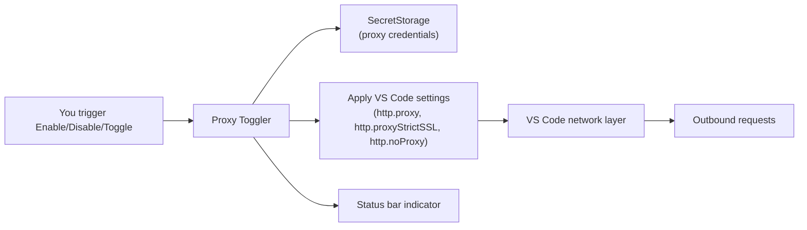

# 🔌 Proxy Toggler (VS Code Extension)


Lightweight on/off control for VS Code’s HTTP proxy with credentials stored in your OS keychain (VS Code SecretStorage). Built for devs who bounce between corporate proxies, VPNs, and local networks.


## ✨ Highlights

- One-click toggle from the Command Palette or status bar.
- Keeps proxy credentials out of settings, logs, and source control.
- Visual status: enabled/disabled indicator plus optional confirm-before-toggle.
- Strict SSL and no-proxy entries supported; leaves system proxy untouched.
- Tested path to publish: `npm run package` produces the VSIX.

## ⚡ Quickstart

1) Install: `code --install-extension ./proxy-toggler-*.vsix` (or grab the Marketplace link once published).  
2) Press `Cmd/Ctrl+Shift+P` → **Proxy Toggler: Configure Proxy Settings** → enter URL/port, strict SSL, no-proxy list, and optional credentials (stored in SecretStorage).  
3) Toggle as needed:
- **Proxy Toggler: Enable Proxy**
- **Proxy Toggler: Disable Proxy**
- **Proxy Toggler: Toggle Proxy**

Status bar shows the current state; click it to toggle.

## ⌨️ Commands

| Command | Palette label |
| --- | --- |
| `proxyToggler.configure` | Proxy Toggler: Configure Proxy Settings |
| `proxyToggler.enable` | Proxy Toggler: Enable Proxy |
| `proxyToggler.disable` | Proxy Toggler: Disable Proxy |
| `proxyToggler.toggle` | Proxy Toggler: Toggle Proxy |

## ⚙️ Settings

| Setting | Type | Default | Purpose |
| --- | --- | --- | --- |
| `proxyToggler.confirmBeforeToggle` | boolean | `false` | Prompt before switching proxy state. |

## 🧭 What It Manages (VS Code user settings)

- `http.proxy`
- `http.proxyStrictSSL`
- `http.noProxy`

## 🧩 How It Works



## ⬇️ Install (from source)

Prereqs: VS Code `1.85+`, Node.js `20+`.

```sh
npm ci
npm run package
code --install-extension ./proxy-toggler-*.vsix
```

## 🔐 Security Notes

- Credentials live only in SecretStorage (OS keychain), never in `settings.json`, `globalState`, logs, or URLs.
- The extension does not set `http.proxyAuthorization`.
- VS Code/Electron may still prompt for auth depending on your proxy/network.

## 🛠️ Troubleshooting

- Toggle not changing? Ensure user-level proxy settings aren’t overridden by workspace settings.
- Connection still blocked? Some environments require system-level proxy configuration; this extension only updates VS Code’s HTTP proxy settings.
- Credential prompt loop? Clear saved creds via the Command Palette (`Proxy Toggler: Configure Proxy Settings`) and re-enter.

## 🤝 Contributing

```sh
npm ci
npm test
npm run lint
```

Run locally: open in VS Code, press `F5` (Extension Development Host).  
Integration tests (downloads VS Code runtime on first run): `npm run test:integration`

## 🎨 Branding assets

- Extension icon: `assets/icon.png` (source `assets/icon.svg`)
- README/banner: `assets/hero.png` (source `assets/hero.svg`)
