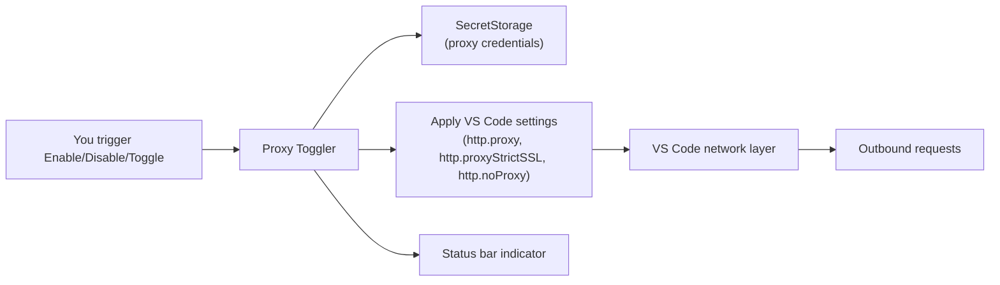

# Proxy Toggler

<p align="center">
  <a href="https://github.com/bluecloud-dev/proxy-toggler/actions/workflows/ci.yml">
    
  </a>
  <a href="https://github.com/bluecloud-dev/proxy-toggler/releases">
    
  </a>
  <a href="LICENSE">
    
  </a>
</p>

<p align="center">
  
</p>

<p align="center">
  Lightweight on/off control for VS Code's HTTP proxy with credentials stored in your OS keychain.
</p>

<!-- Marketplace badges will go here once published -->

---

## Table of Contents

- [Features](#star-features)
- [Requirements](#clipboard-requirements)
- [Quick Start](#zap-quick-start)
- [Commands](#keyboard-commands)
- [Settings](#gear-settings)
- [How It Works](#bulb-how-it-works)
- [Security](#lock-security)
- [Troubleshooting](#wrench-troubleshooting)
- [Contributing](#handshake-contributing)
- [License](#page_facing_up-license)

## :star: Features

- **Proxy profiles**: keep several proxies and switch between them from the status bar gear
- **One-click toggle** from the Command Palette or status bar
- **Secure credential storage** using VS Code SecretStorage (OS keychain) — never in settings, logs, or source control
- **Visual status indicator** showing on or off and the current profile
- **Optional confirmation prompt** before toggling
- **Strict SSL and no-proxy list** support
- **Non-invasive** — leaves system proxy configuration untouched

## :clipboard: Requirements

- VS Code **1.97** or later

## :zap: Quick Start

1. Install from the [VS Code Marketplace](#) or via VSIX:

   ```sh
   code --install-extension proxy-toggler-*.vsix
   ```

2. Open Command Palette (`Cmd/Ctrl+Shift+P`) and run:

   ```
   Proxy Toggler: Configure Proxy Settings
   ```

3. Enter your proxy URL, port, strict SSL preference, no-proxy list, and optional credentials.

4. Toggle the proxy using any of these methods:
   - Click the status bar indicator
   - Run `Proxy Toggler: Toggle Proxy` from Command Palette
   - Use the Turn Proxy On and Turn Proxy Off commands directly

5. Switch profiles by clicking the gear next to the indicator, or run
   `Proxy Toggler: Switch Profile…`. The list opens on the current profile, so Enter keeps it, or
   turns it on while the proxy is off.

## :keyboard: Commands

| Command                                   | Description                                                               |
| ----------------------------------------- | ------------------------------------------------------------------------- |
| `Proxy Toggler: Configure Proxy Settings` | Add the first profile, or edit the current one                            |
| `Proxy Toggler: Switch Profile…`          | Pick a profile to turn on, turn the proxy on or off, or open the settings |
| `Proxy Toggler: Turn Proxy On`            | Turn the current profile on                                               |
| `Proxy Toggler: Turn Proxy Off`           | Turn the proxy off                                                        |
| `Proxy Toggler: Toggle Proxy`             | Turn the current profile on, or the proxy off                             |

## :gear: Settings

| Setting                                | Type    | Default | Description                                                                                                                                     |
| -------------------------------------- | ------- | ------- | ----------------------------------------------------------------------------------------------------------------------------------------------- |
| `proxyToggler.profiles`                | array   | `[]`    | The proxy profiles, shared by every VS Code Profile. Edit them in the application settings (**Preferences: Open Application Settings (JSON)**). |
| `proxyToggler.confirmBeforeToggle`     | boolean | `false` | Ask before the status bar toggle or the Toggle Proxy command turns the proxy on or off                                                          |
| `proxyToggler.showSwitchNotifications` | boolean | `false` | Show a short notification naming the profile when the proxy turns on or off or switches profiles                                                |

### Managed VS Code Settings

This extension manages the following VS Code settings:

- `http.proxy` — The proxy URL
- `http.proxyStrictSSL` — Whether to verify SSL certificates
- `http.noProxy` — Hosts to exclude from proxy

## :bulb: How It Works



## :lock: Security

- **Credentials are stored securely** in VS Code's SecretStorage, which uses your OS keychain
- **No credentials in plain text** — never written to `settings.json`, `globalState`, logs, or URLs
- **No `http.proxyAuthorization`** header is set by this extension
- VS Code/Electron may still prompt for authentication depending on your proxy configuration
- **Works in Restricted Mode**: the extension reads no workspace files, so it stays available in folders you have not trusted
- **Report vulnerabilities privately**; see [SECURITY.md](SECURITY.md)

## :wrench: Troubleshooting

**Toggle not changing settings?**
Ensure user-level proxy settings aren't being overridden by workspace settings.

**Connection still blocked after enabling?**
Some environments require system-level proxy configuration. This extension only manages VS Code's internal HTTP proxy settings.

**Stuck in credential prompt loop?**
Clear saved credentials via `Proxy Toggler: Configure Proxy Settings` and re-enter them.

**Something failed and the notification did not say why?**
Open **View → Output** and pick **Proxy Toggler** in the dropdown. Errors are logged there with details; credentials never are.

## :handshake: Contributing

### Getting started

You need Node.js 24 (the version in `.nvmrc`; run `nvm use` if you use nvm) and VS Code 1.97 or later.

```sh
git clone https://github.com/bluecloud-dev/proxy-toggler.git
cd proxy-toggler
npm ci
npm run check
```

`npm run check` runs the format check, lint, the unused-code check, the type check, and the unit and security tests with coverage. It is what CI runs before the integration tests.

### Run the extension

1. Run `npm run watch` to rebuild `dist/extension.js` on every change, or `npm run build` once.
2. Open the folder in VS Code and press `F5`. If VS Code asks for a debugger, choose **VS Code Extension Development**.
3. Use the commands in the new Extension Development Host window. Errors appear in **Output → Proxy Toggler**.

### Common workflows

| Task                                              | Command                    |
| ------------------------------------------------- | -------------------------- |
| Format all project files                          | `npm run format`           |
| Lint (ESLint with type information)               | `npm run lint`             |
| Find unused files, exports, and dependencies      | `npm run lint:unused`      |
| Type-check                                        | `npm run typecheck`        |
| Unit and security tests                           | `npm test`                 |
| The same, with the coverage gate                  | `npm run coverage`         |
| Integration tests in VS Code (minimum and stable) | `npm run test:integration` |
| Build the VSIX and check its contents             | `npm run package`          |
| Run the built VSIX in Restricted Mode             | `npm run test:packaged`    |

On Linux without a display, prefix the integration and packaged tests with `xvfb-run -a`. The first run downloads VS Code into `.vscode-test/`.

### Where to look next

- [ARCHITECTURE.md](ARCHITECTURE.md): layers, persisted data, the error model, and design decisions.
- [TESTING.md](TESTING.md): how the tests are organized, the shared fakes, and the manual QA checklist.
- [QUALITY_BASELINE.md](QUALITY_BASELINE.md): the coding, TypeScript, extension, and dependency standards.
- [CONTRIBUTING.md](CONTRIBUTING.md): what to read and run before a pull request.
- [SECURITY.md](SECURITY.md): how to report a vulnerability, and the security controls with their tests.
- [CHANGELOG.md](CHANGELOG.md): version history.

## :page_facing_up: License

[MIT](LICENSE)

---

<p align="center">
  <a href="https://github.com/bluecloud-dev/proxy-toggler/issues/new?template=bug_report.yml">Report a Bug</a>
  ·
  <a href="https://github.com/bluecloud-dev/proxy-toggler/issues/new?template=feature_request.yml">Request a Feature</a>
  ·
  <a href="https://github.com/bluecloud-dev/proxy-toggler/security/advisories/new">Report a Vulnerability</a>
</p>
