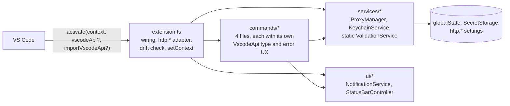
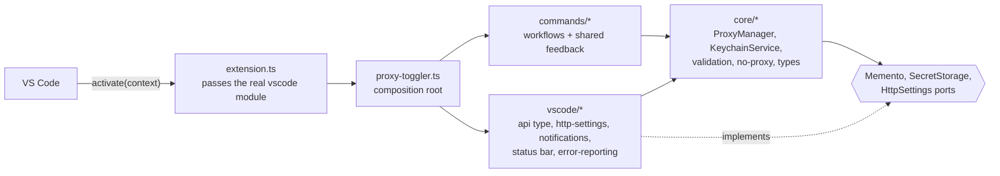
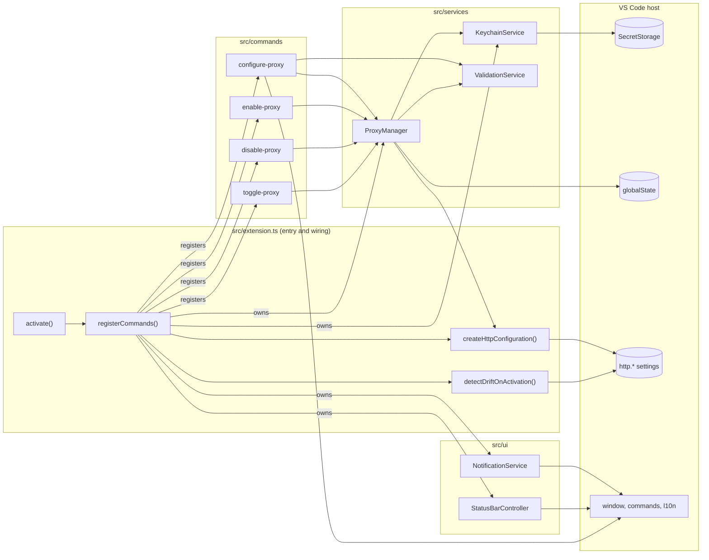

# Refactor report

Branch `refactor/quality-baseline`, 24 commits on top of `main` (`88f1dc0`), not pushed. Appendix A
is the plan as it was written and committed before any code changed.

## Executive summary

The extension now has one architecture, one pattern for each cross-cutting concern, and tooling
that enforces both. User-facing behavior is preserved, except for the changes listed under
[Behavior changes](#behavior-changes).

| Measure                                              | Before (`main`)                              | After                                                                |
| ---------------------------------------------------- | -------------------------------------------- | -------------------------------------------------------------------- |
| Production source (`src`)                            | 2,101 lines, 12 files                        | 1,297 lines, 19 files                                                |
| Comment lines in `src`                               | 508                                          | 24, each explaining a constraint                                     |
| Tests                                                | 2,802 lines; 66 unit/security, 7 integration | 1,910 lines; 82 unit/security, 7 integration on two VS Code versions |
| Coverage (statements / branches / functions / lines) | 90.4 / 81.6 / 92.1 / 90.2                    | 94.2 / 84.1 / 97.9 / 94.1                                            |
| VSIX contents                                        | 45 files, 105.9 KB                           | 12 files, 59.5 KB                                                    |
| High-severity `npm audit` advisories (all dev-only)  | 24                                           | 0                                                                    |
| Files that fail the repo's own Prettier config       | 37                                           | 0                                                                    |

Problems found on the way, and how they were handled:

- **The extension could not enable the proxy on its declared minimum VS Code.** `http.noProxy`
  first shipped in VS Code 1.91, but `engines.vscode` said `^1.85.0`. On 1.85–1.90, enabling
  wrote `http.proxy` and then failed. The new minimum-engine integration run exposed this; the
  engine floor is now 1.91.
- **The toolchain was broken on current platforms.** Mocha 10 crashed on Node 26, and
  `@vscode/test-electron` 2.5 could not launch VS Code 1.110+ on macOS. Fixed by upgrading.
- **Every `npm install` and `npm ci` ran lint, the tests, and two builds** through npm's
  deprecated `prepublish` script. Removed; CI and the release workflow now run the checks
  explicitly.
- **The VSIX shipped duplicate and stale build output.** esbuild now bundles into a cleaned
  `dist/`, which is all that ships.
- **Errors were swallowed.** One command registrar and one background-task helper now log every
  unexpected failure to a **Proxy Toggler** output channel.

How the work landed, in order:

1. Plan (`2723db0`).
2. Tooling (`741d0a7` to `61afc3f`): toolchain repair, ESLint 10, audit fixes, Prettier and
   EditorConfig, tsconfig, knip, the `dist/` build, the engine fix, and CI.
3. Mechanical (`32c1351` to `7da0fdb`): formatting, autofixes, comment cleanup, file moves. Each
   was checked for an unchanged bundle.
4. Structural (`e208b98` to `cd550ce`): composition root and VS Code boundary, core APIs, shared
   UI code, shared test fakes.
5. Improvements and deletions (`48068a1` to `79a3689`): logging, error causes, legacy removal,
   and the lint-enforced layer boundary.
6. Documentation: this report, `QUALITY_BASELINE.md`, `ARCHITECTURE.md`, `TESTING.md`, and the
   README.

## Best-practice comparison

The full benchmark is in [A.6](#a6-benchmark). Highlights, and what this repository adopted:

- **Bundling into `dist/` (5 of 7 projects).** Adopted. The VSIX now contains only
  `dist/extension.js`.
- **Flat ESLint config (6 of 7) and Prettier with `eslint-config-prettier` (4 of 7).** Adopted.
  Typed linting (`recommendedTypeChecked`) follows prettier-vscode.
- **`.nvmrc` as the Node source for CI (prettier-vscode).** Adopted.
- **Integration tests on the `engines.vscode` minimum and on stable (rust-analyzer).** Adopted.
  This is what exposed the `http.noProxy` bug.
- **`createOutputChannel(name, { log: true })` (4 of 7).** Adopted.
- **`"activationEvents": []` for commands-only activation (official esbuild sample).** Adopted.
- **Format and type checks in CI (prettier-vscode, rust-analyzer, GitLens).** Adopted.
- **Not adopted:** SHA-pinned actions (rust-analyzer) and a dependency bot (1 of 7). Both are
  recorded as follow-ups.
- **Beyond the benchmark:** a coverage gate and knip; none of the seven projects use either.

## Standards introduced

[QUALITY_BASELINE.md](QUALITY_BASELINE.md) is the standard. The mechanisms that enforce it:

| Standard                                                                                   | Enforced by                                                |
| ------------------------------------------------------------------------------------------ | ---------------------------------------------------------- |
| Formatting (Prettier 3.9.10, exact) and EditorConfig                                       | `npm run format:check` in CI                               |
| Typed lint rules, import order, `import type`, `type` aliases                              | `npm run lint` (ESLint 10, typescript-eslint)              |
| Runtime `vscode` import only in `src/extension.ts`; `core` independent of the other layers | `no-restricted-imports` in `eslint.config.mjs`             |
| No unused files, exports, or dependencies                                                  | `npm run lint:unused` (knip)                               |
| Strict TypeScript plus four extra flags                                                    | `npm run typecheck`                                        |
| 80% coverage minimum                                                                       | `npm run coverage` (nyc)                                   |
| Works on the minimum and the latest VS Code                                                | `npm run test:integration`                                 |
| No telemetry; no high advisories                                                           | `check:no-telemetry`, `npm audit --audit-level=high` in CI |
| Releases pass the same checks                                                              | `.github/workflows/release.yml`                            |

## Architecture: before and after

Before, `src/extension.ts` built everything, adapted `http.*` settings, ran the drift check, and
accepted the VS Code API as an optional parameter for tests. Seven modules each declared their own
partial copy of the VS Code API.



After, each layer has one job, and the import rules are enforced by lint:



## Behavior changes

| Change                                                                                         | Why                                                                                                        | Commit    | Rollback                                                                                            |
| ---------------------------------------------------------------------------------------------- | ---------------------------------------------------------------------------------------------------------- | --------- | --------------------------------------------------------------------------------------------------- |
| `engines.vscode` raised from `^1.85.0` to `^1.91.0`                                            | `http.noProxy` first shipped in 1.91; on 1.85–1.90 enabling failed partway (see the commit for the source) | `c8fcd6f` | `git revert c8fcd6f`. Users on 1.85–1.90 would again install a version that cannot enable the proxy |
| New **Proxy Toggler** entry in the Output panel                                                | Unexpected errors were swallowed or shown with no detail                                                   | `48068a1` | `git revert 48068a1` (this also reverts the next two rows)                                          |
| Configure with a locked or unavailable keychain shows the keychain message                     | The credential check ran before any error handler, so VS Code showed its generic "command failed" error    | `48068a1` | As above                                                                                            |
| An unexpected failure inside the configure prompts shows "Failed to save proxy configuration." | Every command now has one failure message for errors it cannot explain                                     | `48068a1` | As above                                                                                            |
| The VSIX contains only `dist/extension.js` and assets                                          | Duplicate and stale build output was shipped                                                               | `47aed29` | `git revert 47aed29`; no user-visible effect                                                        |
| `"activationEvents": []`                                                                       | Contributed commands activate the extension implicitly since VS Code 1.74                                  | `51a1271` | `git revert 51a1271`; activation is identical (an integration test proves it)                       |

Internal changes with no user-visible effect: the test-facing `getStatusBarText()` returns the
last text after disposal instead of `undefined`, and `ProxyManager.getState()` ignores unknown keys
in the stored state object, which this extension never writes.

## Risk assessment and compatibility

- **Persisted data is unchanged.** Storage keys, secret keys, stored shapes, and the order of
  `http.*` writes are the same. Unit tests now pin the storage keys and shapes.
- **CI has not run on these workflows.** The branch is not pushed, so the new CI steps were run
  locally on macOS only. Three CI-specific risks:
  - CI now uses Node 24. npm 11.19 and later block dependency install scripts; `allowScripts`
    denies the three affected packages, which a clean local `npm ci` showed are not needed.
  - VS Code 1.91 will run under `xvfb` on ubuntu-latest for the first time.
    `@vscode/test-electron` 3.1 passes `--no-sandbox` by default, which covers the usual Electron
    sandbox failure on Ubuntu 24.04.
  - The release workflow now runs the integration tests, so tagging takes longer.
- **The test runner is pinned to Mocha 11.** Mocha 12 is ESM-only and cannot load in VS Code
  1.91's extension host. Mocha 11 pins a vulnerable `serialize-javascript` (`^6`), so an npm
  `overrides` entry forces the patched `^7.0.5`. Mocha loads that package only in `--parallel`
  mode, which this project does not use (`5d0fa33`).
- **Developer machines need Node 22 or later**, because `@vscode/test-electron` 3 requires it.
  `.nvmrc` selects 24.
- **Pre-existing behavioral risks are unchanged**; see [A.4](#a4-risk-areas) and the follow-ups.

## How to run

| Task                                          | Command                                             |
| --------------------------------------------- | --------------------------------------------------- |
| Install                                       | `npm ci` (Node from `.nvmrc`)                       |
| Develop                                       | `npm run watch`, then press F5 in VS Code           |
| Build                                         | `npm run build` (type check and development bundle) |
| Production bundle                             | `npm run vscode:prepublish`                         |
| Lint                                          | `npm run lint`                                      |
| Unused code                                   | `npm run lint:unused`                               |
| Format / check formatting                     | `npm run format` / `npm run format:check`           |
| Type check                                    | `npm run typecheck`                                 |
| Unit and security tests                       | `npm test` (`npm run coverage` adds the gate)       |
| Integration tests                             | `npm run test:integration` (`xvfb-run -a` on Linux) |
| Everything CI checks before integration tests | `npm run check`                                     |
| Package                                       | `npm run package`                                   |

## Removed legacy code

| Removed                                                                                                                               | Evidence                                                                                                  | Commit    |
| ------------------------------------------------------------------------------------------------------------------------------------- | --------------------------------------------------------------------------------------------------------- | --------- |
| npm `prepublish` script                                                                                                               | npm documents that it runs on `npm install` and `npm ci`; a scratch package confirmed this with npm 11.19 | `741d0a7` |
| `.eslintrc.json`, `.eslintignore`, ESLint 8                                                                                           | ESLint 8 is end-of-life; ESLint 10 uses flat config only                                                  | `bfc344b` |
| `forceConsistentCasingInFileNames` and implicit `node10` resolution                                                                   | Default since TypeScript 5.0; deprecated in TypeScript 6.0                                                | `156dc24` |
| `tsc` output in `out/src` used as the shipped extension                                                                               | The VSIX listing showed duplicate and stale modules                                                       | `47aed29` |
| 507 boilerplate JSDoc lines                                                                                                           | They restated names and signatures; the bundle was byte-identical without them                            | `dac4bc4` |
| Four `.gitkeep` files                                                                                                                 | Their folders are not empty                                                                               | `7da0fdb` |
| Test-only `activate()` parameters, the `require('vscode')` cast, and the `Module._load` test patch                                    | Replaced by the composition root; the compiler now checks the real module                                 | `e208b98` |
| Seven hand-written VS Code API type copies                                                                                            | Replaced by `src/vscode/api.ts`                                                                           | `e208b98` |
| Static-only `ValidationService`; public `validatePort` and `validateScheme`                                                           | No callers outside `validateProxyUrl`; knip now guards exports                                            | `c1e6c57` |
| `SaveConfigurationOptions`, its type guard, and the translation helper                                                                | Replaced by the `CredentialsUpdate` union used end to end                                                 | `c1e6c57` |
| Duplicate `DEFAULT_NO_PROXY` and bypass-list normalizers                                                                              | Consolidated in `core/no-proxy.ts`                                                                        | `c1e6c57` |
| Three copies of the state-command error UX; three identical notification methods; three status bar branches; two-phase `initialize()` | Consolidated without changing messages or actions                                                         | `b770711` |
| The integration test's own `noProxy` parser                                                                                           | `http.noProxy` is always an array on VS Code 1.91 and later                                               | `cd550ce` |
| The unreachable "Invalid configuration input." fallback                                                                               | `validateCredentials` throws only `ValidationError`                                                       | `48068a1` |
| `Object.setPrototypeOf` in three error classes, `cause` parameter properties, `asError` helpers, the one enum                         | The TypeScript handbook limits the workaround to ES5 output; the project targets ES2022                   | `8ab2b88` |
| `onCommand:` activation events                                                                                                        | VS Code docs (implicit since 1.74) plus a new integration test                                            | `51a1271` |
| No-op `dispose()` on `ProxyManager` and `KeychainService`                                                                             | They held no resources                                                                                    | `51a1271` |
| `KeychainService.retrieveCredentials()`                                                                                               | No production caller                                                                                      | `51a1271` |
| The string-shaped `http.noProxy` write path and `inspect`                                                                             | `type: 'array'` since the setting appeared in 1.91                                                        | `51a1271` |
| Three `assert.equal(true, true)` smoke tests                                                                                          | The other tests in each folder already prove that the runners start                                       | `51a1271` |

Kept on purpose: `scripts/patch-os-cpus.cjs`. Some sandboxed environments report zero CPUs, and
nyc and vsce size their worker pools from `os.cpus()`. The script now carries a one-line comment
saying so.

## Comment policy outcome

`src` has 24 comment lines, down from 508. Each states a constraint or a reason the code cannot
show: credentials never reach `globalState`; activation must stay keychain-free; settings are
written in a fixed order; `http.noProxy` is an array; literal `l10n.t` calls keep strings
extractable; keychain reasons are guessed from messages. Longer explanations now live in:

- [ARCHITECTURE.md](ARCHITECTURE.md): layers, ports, persisted data, the error model, and design
  decisions.
- [QUALITY_BASELINE.md](QUALITY_BASELINE.md): conventions and why they exist.
- [TESTING.md](TESTING.md): test strategy and the manual QA checklist.
- Commit messages: the evidence for each removal and behavior change.

## Assumptions

- Working autonomously, I committed each step to a local branch so that the three-step ordering
  is reviewable. Nothing was pushed, and no pull request was opened.
- The Microsoft Learn MCP server has no VS Code extension documentation, which lives on
  code.visualstudio.com. I used Context7's index of those official pages instead and recorded the
  Learn query results.
- The local, untracked `proxy-toggler-constitution.md` asks for JSDoc on every public function.
  This brief's comment-light rule supersedes it, so JSDoc was removed and the "why" kept.
- I chose Node 24 LTS for development and CI because Node 20 is end-of-life and Node 24 is
  supported until April 2028.
- `trailingComma: "none"` matches the existing code and keeps the one-time formatting diff small.
- GitHub Actions stay on their current major versions, because this branch cannot run CI to
  verify an upgrade.
- `.vscode/` is ignored by the local `.gitignore`, which local hooks protect from commits, so no
  launch configuration was committed. The README explains how to start the Extension Development
  Host without one.
- Local VSIX builds in the working tree (`proxy-toggler-0.1.0.vsix`) were regenerated during
  validation. They are untracked build artifacts.

## Follow-ups deliberately left out

These are pre-existing issues that the refactor does not depend on. They are ordered by
importance.

1. **Decide what credentials are for.** The extension collects and stores a proxy username and
   password but never uses them (no `http.proxyAuthorization`, nothing passed to VS Code).
   Collecting secrets that are never used adds risk without benefit. Either use them or stop
   asking for them.
2. **Stale drift sync.** The drift check computes the applied state before awaiting the user's
   answer and writes it afterwards. If the user toggles in between, the write is stale. Recompute
   after the answer.
3. **Concurrent commands.** Two quick toggles interleave read-modify-write cycles. Serialize state
   transitions.
4. **Partial enable.** If the second or third `http.*` write fails, the earlier writes stay. Roll
   them back, or report the partial state.
5. **Passwords are trimmed** before storage, so leading or trailing spaces are lost.
6. **Localization is only partly extractable.** There is no `l10n` bundle yet, and messages passed
   through `NotificationService`, as well as `ValidationError` text, reach `l10n.t` as variables.
7. **UX polish.** Use `category` in `contributes.commands` instead of a hard-coded "Proxy
   Toggler:" title prefix. Give the status bar item an `id` and `name`. React to `http.*` changes
   made outside the extension with `onDidChangeConfiguration`.
8. **Supply chain.** Actions are three major versions behind (`checkout`, `setup-node`, and
   `upload-artifact` v4 to v7; `action-gh-release` v2 to v3) and are not pinned to commit SHAs.
   Add Dependabot for npm and GitHub Actions; a ready configuration is below.
9. **Dev dependency majors.** nyc 18 (which clears the remaining moderate `uuid` advisory),
   `@vscode/vsce` 4, sinon 22, and a replacement for the unmaintained ts-node (tsx, or Node's own
   type stripping).
10. **TypeScript 6 and 7.** The tsconfig is already compatible with TypeScript 6's deprecations.
11. **Publishing.** Marketplace and Open VSX publishing from the release workflow.
12. **Drift detection reads effective values.** Workspace settings can override the global
    settings the extension writes.

A ready Dependabot configuration (`.github/dependabot.yml`):

```yaml
version: 2
updates:
  - package-ecosystem: github-actions
    directory: /
    schedule: { interval: weekly }
  - package-ecosystem: npm
    directory: /
    schedule: { interval: weekly }
    groups:
      dev-dependencies: { dependency-type: development, update-types: [minor, patch] }
```

## LOC impact summary

Net change per area (lines at `main` and at the branch tip):

| Area                                                              | Before | After | Change      |
| ----------------------------------------------------------------- | ------ | ----- | ----------- |
| Core (`src/core`; formerly `services/` and `types/`)              | 890    | 513   | −377 (−42%) |
| UI (`src/commands`, notifications, status bar)                    | 957    | 583   | −374 (−39%) |
| Integrations (`extension.ts`, composition root, VS Code adapters) | 258    | 201   | −57 (−22%)  |
| Tests                                                             | 2,802  | 1,910 | −892 (−32%) |
| Tooling (config, scripts, CI)                                     | 539    | 617   | +78         |
| Documentation (`*.md`; 314 lines are the plan appendix)           | 165    | 1,230 | +1,065      |

Added and removed lines by category, summed over the commits in each category:

| Category                                          | `src` added | `src` removed | tests added | tests removed |
| ------------------------------------------------- | ----------- | ------------- | ----------- | ------------- |
| Formatting (Prettier, autofixes)                  | 113         | 39            | 124         | 56            |
| Deleted comments                                  | 8           | 506           | 0           | 0             |
| Moved (769 lines in seven files changed location) | 26          | 30            | 23          | 23            |
| Consolidated (structural commits)                 | 808         | 1,178         | 1,315       | 2,401         |
| Improvements (logging, error causes)              | 122         | 98            | 105         | 3             |
| Deleted legacy and dead code                      | 6           | 40            | 41          | 45            |
| Edits required by new tooling                     | 2           | 2             | 58          | 30            |

Places where I chose not to shorten the code:

1. **The configure wizard (`configure-proxy.ts`, 267 lines)** keeps one function per prompt with
   literal `l10n.t` strings. A table-driven step engine would be shorter but would hide the flow
   and make the strings impossible to extract.
2. **`StatusBarController.presentationFor`** keeps three explicit branches instead of a lookup
   table, for the same reason.
3. **Bypass-list validation** keeps one `if` and one message per rule. A combined regular
   expression would be shorter, but the messages are user-facing and differ per rule.
4. **Command dependencies are narrow `Pick<…>` types** rather than whole classes. The signatures
   are a little longer, but each command documents what it uses and tests need no casts.
5. **The integration runner (+30 lines)** reads `engines.vscode` and runs the suite twice. It
   costs time, and it caught the `http.noProxy` bug.

## References

Every documentation source used is listed in
[QUALITY_BASELINE.md → References](QUALITY_BASELINE.md#references). The benchmark sources are
in [A.6](#a6-benchmark). The evidence for individual removals and behavior changes is in the
commit messages on this branch.

## Appendix A — Refactor plan (written before execution)

### A.1 Codebase map

**What the extension does.** Proxy Toggler stores a proxy configuration (URL, strict SSL flag,
bypass list) in `globalState`, stores optional credentials in `SecretStorage`, and switches VS
Code's global `http.proxy`, `http.proxyStrictSSL`, and `http.noProxy` settings on and off. A
status bar item shows the state; four commands drive it.

**Entry point.** `src/extension.ts` exports `activate(context, vscodeApi?, importVscodeApi?)`. The
two optional parameters exist only for unit tests. `activate` calls `registerCommands`, which
builds every service, starts two background tasks (UI refresh and settings drift check), and
registers the commands. The return value is a small API that integration tests read.

**Subsystems.**

| Area             | Files                                                                 | Responsibility                                                                                      |
| ---------------- | --------------------------------------------------------------------- | --------------------------------------------------------------------------------------------------- |
| Entry and wiring | `src/extension.ts`                                                    | Composition, `http.*` write adapter (string vs array `noProxy`), drift detection, `setContext` keys |
| Commands         | `src/commands/{configure,enable,disable,toggle}-proxy.ts`             | One file per command: prompts, calls `ProxyManager`, renders errors                                 |
| Services         | `src/services/{proxy-manager,keychain-service,validation-service}.ts` | Persistence and toggle state, credential storage, input validation                                  |
| UI               | `src/ui/{notification-service,status-bar-controller}.ts`              | Localized notifications with action ids, status bar item                                            |
| Types            | `src/types/{proxy-configuration,toggle-state}.ts`                     | Shared data shapes                                                                                  |

No module imports `vscode` at runtime except `extension.ts` (through `require`). Every other
module receives a hand-written, partial `VscodeApi` type as a parameter.

**Build pipeline.**

- `npm run build` runs `tsc -p .` and emits `src` and `tests` into `out/`. It never cleans `out/`.
- `npm run bundle` runs esbuild (minified, with source map) and overwrites `out/src/extension.js`.
- `vscode:prepublish` runs both; `vsce package` ships `files: ["out/src/**", ...]`. The VSIX
  therefore contains the bundle, its 89 KB source map, and every unbundled module that `tsc`
  emitted. The locally built `proxy-toggler-0.1.0.vsix` also contains modules whose sources no
  longer exist (`out/src/commands/keychain-error-messages.js`, `out/src/*/index.js`).
- npm's deprecated `prepublish` script runs `lint`, `test`, `build`, and `bundle`. npm runs
  `prepublish` on every `npm install` and `npm ci` (confirmed with npm 11.19 in a scratch package).

**Test setup.**

- Unit and security tests: Mocha 10 with `ts-node/register` over `tests/unit/**` and
  `tests/security/**` (66 tests). Each file builds its own fakes. `nyc` enforces 80% on
  statements, branches, functions, and lines.
- Integration tests: `tsc` output in `out/tests/integration`, launched by `tests/run-test.ts`
  through `@vscode/test-electron` 2.5.2 against VS Code stable, with temporary user-data and
  extensions directories. Mocha runs inside the extension host.
- CI (`.github/workflows/ci.yml`, Node 20, ubuntu-latest): `npm ci`, lint, `tsc`, coverage,
  integration tests under `xvfb-run`, telemetry guard, `npm audit`, `vsce package`, artifact upload.
- Release (`.github/workflows/release.yml`, tag `v*.*.*`): `npm ci`, package, extract notes from
  `CHANGELOG.md`, create a GitHub release. It has no explicit lint or test step; it is gated only
  by the `prepublish` side effect of `npm ci`.

**Module ownership (current).** Arrows labelled "owns" mean "constructs and is responsible for
disposing".



### A.2 Baseline (measured before any change)

| Check                 | Command                               | Result                                                                                                                                                                                                           |
| --------------------- | ------------------------------------- | ---------------------------------------------------------------------------------------------------------------------------------------------------------------------------------------------------------------- |
| Lint                  | `npm run lint`                        | Pass (ESLint 8, `src` and `tests` only)                                                                                                                                                                          |
| Build                 | `npm run build`                       | Pass                                                                                                                                                                                                             |
| Unit + security tests | `npm test` on Node 22.23.1            | 66 passing                                                                                                                                                                                                       |
| Unit + security tests | `npm test` on Node 26.12.0            | Crash before any test: `ReferenceError: require is not defined in ES module scope` (Mocha 10 loading yargs)                                                                                                      |
| Coverage              | `npm run coverage`                    | 90.38% statements, 81.56% branches, 92.10% functions, 90.22% lines                                                                                                                                               |
| Integration           | `npm run test:integration` on macOS   | Fails to start: `spawn .../Visual Studio Code.app/Contents/MacOS/Electron ENOENT`. VS Code 1.110+ renamed the macOS executable to `Code`; `@vscode/test-electron` 2.5.2 hard-codes `Electron`, 3.1.0 resolves it |
| Formatting            | `prettier --check` over tracked files | 37 files differ from the repo's own `.prettierrc`                                                                                                                                                                |

### A.3 Top ten quality issues, ranked by impact

1. **The VSIX ships duplicate and stale build output.** `tsc` and esbuild write to the same
   `out/src/extension.js`, `out/` is never cleaned, and `files` includes all of `out/src/**`.
   Users download the bundle plus every unbundled module and an 89 KB source map; local builds can
   also ship modules from deleted sources.
2. **The toolchain is broken on current platforms.** Unit tests crash on Node 26, integration tests
   cannot launch VS Code 1.110+ on macOS, and CI runs on Node 20, which reached end of life in 2026. Because `prepublish` runs the tests, `npm install` itself fails on Node 26.
3. **`prepublish` hides the real pipeline.** Every `npm install` and `npm ci` runs lint, tests,
   and two builds. CI therefore runs everything twice, and the release workflow has no quality gate
   of its own.
4. **Failures are silent or unlogged.** Activation-time tasks end in `.catch(() => {})`. Commands
   turn unexpected errors into generic text without recording them anywhere, and there is no log
   output channel. The configure command reads credential presence outside any error handler, so a
   locked keychain surfaces as a raw VS Code error instead of the friendly keychain message.
5. **Style and lint are not enforced.** 37 tracked files fail the repo's Prettier config, CI has no
   format check, ESLint 8 is end-of-life and uses the legacy config format, the build scripts are
   not linted, and there is no import ordering, unused-code detection, or EditorConfig.
6. **VS Code API types are duplicated and force-cast.** Seven modules each declare their own partial
   `VscodeApi`, and `extension.ts` casts `require('vscode') as VscodeApi`, which hides mismatches
   (for example `Promise` where VS Code returns `Thenable`). `@types/vscode` floats to 1.107 while
   the engine is `^1.85.0`, so APIs newer than the supported minimum compile without warning.
7. **Logic is duplicated.** `noProxy` parsing and defaulting appear in five places; the
   "configure first" prompt, the "Proxy enabled / Disable Proxy" flow, and the settings-error UX are
   copied across enable, disable, and toggle; credential prompting is written twice; the three
   `NotificationService` methods and the three status bar branches differ by one token each.
8. **Production code carries test hooks, and tests copy their fakes.** `activate` accepts an
   injected API and a lazy importer only for tests, and one test patches `Module._load`. The 642-line
   `extension.test.ts` repeats the same 80-line fake six times; three "smoke" tests assert
   `true === true`.
9. **Comments drown the code.** 508 of 2,101 source lines are comments, mostly boilerplate JSDoc
   (`@returns void`, `@example manager.dispose()`), which buries the few comments that explain a
   constraint.
10. **Legacy shims and dead code remain.** Explicit `onCommand:` activation events (implicit since
    VS Code 1.74; the engine is `^1.85.0`), the ES5 `Object.setPrototypeOf` workaround in three error
    classes under an ES2022 target, custom `cause` fields that shadow ES2022 `Error.cause`, no-op
    `dispose()` methods registered as subscriptions, `.gitkeep` files in non-empty folders, and
    unused members (`KeychainService.retrieveCredentials`, the exported `registerCommands`, public
    `validatePort` and `validateScheme`).

### A.4 Risk areas

- **Global state.** No mutable module-level state. Persisted keys must stay stable across the
  refactor: `globalState` `proxyToggler.savedProxy` and `proxyToggler.state`, and secrets
  `proxyToggler.credentials.username` and `proxyToggler.credentials.password`.
- **Disposables.** Nothing leaks: commands and the status bar item are registered with
  `context.subscriptions`. Two no-op disposables are registered for no reason. No listener tracks
  `http.*` changes after activation, so external edits are noticed only on the next activation.
- **Async hazards.**
  - The drift check computes "settings match the saved configuration" before awaiting the user's
    answer, then writes that value afterwards. If the user toggles in between (likely when the
    toggle command itself activated the extension), the write is stale.
  - Concurrent commands (for example a double-click on the status bar) interleave
    read-modify-write cycles on toggle state and settings.
  - `enableProxy` writes three settings one by one; a policy-locked second setting leaves the first
    applied with no rollback.
- **Unhandled or swallowed rejections.** Activation tasks swallow errors; the configure command's
  `loadConfiguration` rejection escapes to VS Code.
- **Credential handling.** Credentials live only in `SecretStorage` and never reach settings or
  `globalState` (covered by security tests), and the UI masks them. Weaknesses: credentials are
  collected and stored but never consumed by the extension; passwords are trimmed before storage,
  so leading or trailing spaces are lost; keychain failures are classified by message substrings.
- **Webviews and custom editors.** None. Webview standards are recorded in the baseline for future
  use only.

These are pre-existing behaviors. Unless the refactor needs a change, they are recorded as
follow-ups and not fixed in this work.

### A.5 Duplication and boilerplate hotspots

| Area                 | Hotspot                                                                                                              | Consolidation                                                          | Rough change |
| -------------------- | -------------------------------------------------------------------------------------------------------------------- | ---------------------------------------------------------------------- | ------------ |
| All `src` modules    | Seven hand-written `VscodeApi`-style type blocks                                                                     | One VS Code surface type that the real module satisfies without a cast | -110         |
| `src/commands`       | Configure-first prompt, enabled notice, settings-error UX copied across three commands                               | One shared feedback module                                             | -80          |
| `configure-proxy.ts` | Credential prompts written twice; two identical input validators; `CredentialsUpdate` translated into a second union | One prompt flow, one validator factory, one union end to end           | -60          |
| `src/ui`             | Three identical notification methods; three identical status bar branches                                            | One private `show`; one presentation function                          | -45          |
| `noProxy` rules      | Split, trim, and default logic in five places                                                                        | `core/no-proxy.ts`                                                     | -30          |
| JSDoc                | About 450 boilerplate comment lines                                                                                  | Delete; keep the "why" in one line or move it to docs                  | -430         |
| Error classes        | `setPrototypeOf` x3, `asError` x2, custom `cause` x3                                                                 | ES2022 `{ cause }`                                                     | -15          |
| Tests                | One 80-line fake copied six times; memento, secret, settings, and notification stubs copied across files             | `tests/support` fakes                                                  | -700         |
| Tests                | Three tautological smoke tests                                                                                       | Delete                                                                 | -24          |
| Tooling              | Legacy ESLint files; no EditorConfig, unused-code check, Node pin, or Dependabot                                     | Flat config and new config files                                       | +120         |
| Docs                 | No architecture, testing, or standards documents                                                                     | Five documents and a README developer section                          | +700         |

Expected totals: `src` from about 2,100 to about 1,250 lines; tests from about 2,800 to about
1,900 lines.

### A.6 Benchmark

Seven projects, read from their default branches on 2026-10-18 through the GitHub API: the
official `microsoft/vscode-extension-samples` (helloworld and esbuild samples), `microsoft/vscode-eslint`,
`prettier/prettier-vscode`, `gitkraken/vscode-gitlens`, `microsoft/vscode-pull-request-github`,
`rust-lang/rust-analyzer` (`editors/code`), and `golang/vscode-go` (`extension/`). Three claims
were re-checked at the source: prettier-vscode's CI uses `node-version-file: .nvmrc` and
`prettier --check`; rust-analyzer runs integration tests on the `engines.vscode` minimum and on
stable; the esbuild sample uses `"activationEvents": []` and `"main": "./dist/extension.js"`.

| Practice                                   | Prevalence                                                              | This repo today                              | Standard adopted here                                                                                                                                                                                          |
| ------------------------------------------ | ----------------------------------------------------------------------- | -------------------------------------------- | -------------------------------------------------------------------------------------------------------------------------------------------------------------------------------------------------------------- |
| `strict` TypeScript                        | 6 of 7                                                                  | Yes                                          | Keep; add `noImplicitOverride`, `noImplicitReturns` (3 of 7 each), `noFallthroughCasesInSwitch`, and `noUncheckedIndexedAccess` (rust-analyzer). Leave `exactOptionalPropertyTypes` off, as rust-analyzer does |
| ESLint flat config                         | 6 of 7 (GitLens uses oxlint)                                            | Legacy `.eslintrc.json`, ESLint 8            | ESLint 10 flat config                                                                                                                                                                                          |
| Type-aware lint rules                      | prettier-vscode (`recommendedTypeChecked`), vscode-eslint (hand-picked) | None                                         | `recommendedTypeChecked`: cheap at this size, and it catches floating promises                                                                                                                                 |
| Prettier, with `eslint-config-prettier`    | 4 of 7                                                                  | Configured, not enforced                     | Enforce in CI with `format:check`                                                                                                                                                                              |
| EditorConfig                               | 3 of 7                                                                  | None                                         | Add                                                                                                                                                                                                            |
| Bundler with `main` in `dist/`             | Bundler 7 of 7; `dist/` 5 of 7                                          | esbuild into `out/`, mixed with `tsc` output | esbuild into a cleaned `dist/`                                                                                                                                                                                 |
| Real VS Code integration tests             | 5 of 7                                                                  | Yes                                          | Keep                                                                                                                                                                                                           |
| Minimum engine plus stable in tests        | rust-analyzer, which reads `engines.vscode`                             | Stable only                                  | Adopt the rust-analyzer approach                                                                                                                                                                               |
| GitHub Actions with `npm ci`               | 6 of 7                                                                  | Yes                                          | Keep; Node from `.nvmrc`, as prettier-vscode does                                                                                                                                                              |
| Format and type checks in CI               | prettier-vscode, rust-analyzer, GitLens                                 | Neither                                      | Add                                                                                                                                                                                                            |
| SHA-pinned actions                         | rust-analyzer, one workflow in the PR extension                         | Major tags                                   | Keep major tags; recorded as a follow-up                                                                                                                                                                       |
| Pipeline-driven release                    | 6 of 7                                                                  | Tag builds a GitHub release with no gate     | Run the same checks as CI before packaging                                                                                                                                                                     |
| `createOutputChannel(name, { log: true })` | 4 of 7                                                                  | No logging                                   | Add one log channel                                                                                                                                                                                            |
| `context.subscriptions.push`               | 7 of 7                                                                  | Yes                                          | Keep                                                                                                                                                                                                           |
| Commands-only activation                   | The samples use `"activationEvents": []`                                | Explicit `onCommand:` list                   | `[]`, since commands activate implicitly from VS Code 1.74                                                                                                                                                     |
| Dependabot or Renovate                     | 1 of 7 (actions only)                                                   | None                                         | Not added: it is a maintainer process decision; recorded as a follow-up with a ready config                                                                                                                    |
| Coverage gate; knip or ts-prune            | 0 of 7 each                                                             | Coverage gate                                | Keep the coverage gate and add knip, because unused-code detection is part of this brief even though the benchmark projects lack it                                                                            |

### A.7 Refactor steps and validation

Commits land on `refactor/quality-baseline`, one reviewable concern per commit. Nothing is pushed.

**Step 0 — Tooling** (comes first because later steps depend on it).

1. Repair the toolchain: Mocha 12, `@vscode/test-electron` 3.1, `@types/vscode` pinned to the
   1.85 engine minimum, `.nvmrc` on Node 24 LTS, and removal of the `prepublish` script.
2. ESLint 10 flat config with `typescript-eslint` typed linting, `eslint-config-prettier`, import
   sorting, and a rule that only `src/extension.ts` may import `vscode` at runtime. Delete
   `.eslintrc.json` and `.eslintignore`. Lint the build scripts too.
3. Prettier with explicit options and an allowlist ignore file (so `npm run format` never touches
   untracked local files), plus `.editorconfig`, `format`, and `format:check`.
4. `tsconfig.json`: `module: node16` (TypeScript 6 deprecates `node10` resolution),
   `isolatedModules`, `noImplicitOverride`, `noImplicitReturns`, `noFallthroughCasesInSwitch`, and
   `noUncheckedIndexedAccess`. Add `typecheck`.
5. knip for unused files, exports, and dependencies; an aggregate `check` script.
6. Build: esbuild bundles into a cleaned `dist/`; `main` and `files` point at `dist`; source maps
   only in development builds.
7. CI: Node from `.nvmrc`; format check, lint, unused-code check, type check, coverage, telemetry
   guard, audit, package; integration tests against VS Code stable and the 1.85.0 engine minimum;
   the release workflow runs the same gate before packaging; Dependabot for npm and GitHub Actions.

Validation: `npm run check`, `npm run test:integration` locally on stable and on 1.85.0, and
`npm run package` followed by a listing of the VSIX contents.

**Step 1 — Mechanical** (no semantic change).

- Apply Prettier and import sorting.
- Delete boilerplate JSDoc; keep one-line "why" comments.
- Move files into the target layout (`core/`, `commands/`, `vscode/`).

Validation: the minified production bundle is byte-identical before and after the formatting and
comment commit; tests, type check, and integration tests pass after the moves.

**Step 2 — Structural.**

- Thin `src/extension.ts` that passes the real `vscode` module to a composition root
  (`src/proxy-toggler.ts`), removing the test-only parameters.
- One VS Code surface type; an `http.*` settings adapter; command ids in one place.
- Core modules for `noProxy` rules and validation functions; `CredentialsUpdate` used end to end.
- Shared command feedback; consolidated notification and status bar internals; shared test fakes.

Validation: unit, security, and integration tests; coverage gate; type check; lint.

**Step 3 — Behavior-preserving improvements and deletions.**

- A `LogOutputChannel` and one command-registration helper that logs unexpected errors and shows the
  command's existing failure message, so nothing is swallowed.
- ES2022 error `cause`; string unions instead of the one enum.
- Remove the legacy items listed in A.3 item 10, with evidence for each.

Validation: as in step 2, plus packaging and an activation check in the integration host.

**Step 4 — Documentation.** README developer section, `TESTING.md` with a manual QA checklist,
`ARCHITECTURE.md`, `QUALITY_BASELINE.md`, and the final sections of this report.

### A.8 Documentation sources

- **Microsoft Learn MCP.** Queried for VS Code extension API, activation, SecretStorage, and
  extension security guidance. It returned no pages from the VS Code extension documentation, which
  lives on code.visualstudio.com rather than learn.microsoft.com. It did return general guidance on
  trusting IDE extensions ("Secure the developer environment for Zero Trust"), used in the security
  baseline.
- **Context7, official VS Code docs** (`/websites/code_visualstudio_api`, an index of
  code.visualstudio.com/api): activation events, bundling, testing, publishing and engine
  compatibility, SecretStorage, `LogOutputChannel`, and webview security. Used in place of
  Microsoft Learn for official VS Code guidance.
- **Context7, ecosystem tooling:** `/eslint/eslint/v10.5.0`, `/typescript-eslint/typescript-eslint`,
  `/microsoft/typescript-website` (TypeScript 6.0 deprecations), `/mochajs/mocha`, `/npm/cli`
  (lifecycle scripts), and `/websites/knip_dev`. Prettier, `actions/setup-node`, and Dependabot are
  queried during execution.
