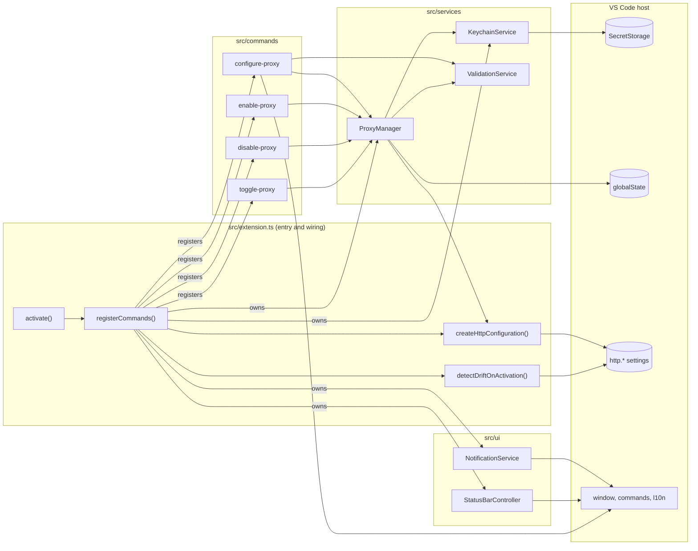

# Refactor report

> **Status:** plan only. This file was written before any code changed. The report sections
> (summary, behavior changes, LOC impact, and the rest) are added when the work is finished; the
> plan below stays as written so reviewers can compare intent with outcome.

## Appendix A — Refactor plan (written before execution)

### A.1 Codebase map

**What the extension does.** Proxy Toggler stores a proxy configuration (URL, strict SSL flag,
bypass list) in `globalState`, stores optional credentials in `SecretStorage`, and switches VS
Code's global `http.proxy`, `http.proxyStrictSSL`, and `http.noProxy` settings on and off. A
status bar item shows the state; four commands drive it.

**Entry point.** `src/extension.ts` exports `activate(context, vscodeApi?, importVscodeApi?)`. The
two optional parameters exist only for unit tests. `activate` calls `registerCommands`, which
builds every service, starts two background tasks (UI refresh and settings drift check), and
registers the commands. The return value is a small API that integration tests read.

**Subsystems.**

| Area             | Files                                                                 | Responsibility                                                                                      |
| ---------------- | --------------------------------------------------------------------- | --------------------------------------------------------------------------------------------------- |
| Entry and wiring | `src/extension.ts`                                                    | Composition, `http.*` write adapter (string vs array `noProxy`), drift detection, `setContext` keys |
| Commands         | `src/commands/{configure,enable,disable,toggle}-proxy.ts`             | One file per command: prompts, calls `ProxyManager`, renders errors                                 |
| Services         | `src/services/{proxy-manager,keychain-service,validation-service}.ts` | Persistence and toggle state, credential storage, input validation                                  |
| UI               | `src/ui/{notification-service,status-bar-controller}.ts`              | Localized notifications with action ids, status bar item                                            |
| Types            | `src/types/{proxy-configuration,toggle-state}.ts`                     | Shared data shapes                                                                                  |

No module imports `vscode` at runtime except `extension.ts` (through `require`). Every other
module receives a hand-written, partial `VscodeApi` type as a parameter.

**Build pipeline.**

- `npm run build` runs `tsc -p .` and emits `src` and `tests` into `out/`. It never cleans `out/`.
- `npm run bundle` runs esbuild (minified, with source map) and overwrites `out/src/extension.js`.
- `vscode:prepublish` runs both; `vsce package` ships `files: ["out/src/**", ...]`. The VSIX
  therefore contains the bundle, its 89 KB source map, and every unbundled module that `tsc`
  emitted. The locally built `proxy-toggler-0.1.0.vsix` also contains modules whose sources no
  longer exist (`out/src/commands/keychain-error-messages.js`, `out/src/*/index.js`).
- npm's deprecated `prepublish` script runs `lint`, `test`, `build`, and `bundle`. npm runs
  `prepublish` on every `npm install` and `npm ci` (confirmed with npm 11.19 in a scratch package).

**Test setup.**

- Unit and security tests: Mocha 10 with `ts-node/register` over `tests/unit/**` and
  `tests/security/**` (66 tests). Each file builds its own fakes. `nyc` enforces 80% on
  statements, branches, functions, and lines.
- Integration tests: `tsc` output in `out/tests/integration`, launched by `tests/run-test.ts`
  through `@vscode/test-electron` 2.5.2 against VS Code stable, with temporary user-data and
  extensions directories. Mocha runs inside the extension host.
- CI (`.github/workflows/ci.yml`, Node 20, ubuntu-latest): `npm ci`, lint, `tsc`, coverage,
  integration tests under `xvfb-run`, telemetry guard, `npm audit`, `vsce package`, artifact upload.
- Release (`.github/workflows/release.yml`, tag `v*.*.*`): `npm ci`, package, extract notes from
  `CHANGELOG.md`, create a GitHub release. It has no explicit lint or test step; it is gated only
  by the `prepublish` side effect of `npm ci`.

**Module ownership (current).** Arrows labelled "owns" mean "constructs and is responsible for
disposing".

### A.2 Baseline (measured before any change)

| Check                 | Command                               | Result                                                                                                                                                                                                           |
| --------------------- | ------------------------------------- | ---------------------------------------------------------------------------------------------------------------------------------------------------------------------------------------------------------------- |
| Lint                  | `npm run lint`                        | Pass (ESLint 8, `src` and `tests` only)                                                                                                                                                                          |
| Build                 | `npm run build`                       | Pass                                                                                                                                                                                                             |
| Unit + security tests | `npm test` on Node 22.23.1            | 66 passing                                                                                                                                                                                                       |
| Unit + security tests | `npm test` on Node 26.12.0            | Crash before any test: `ReferenceError: require is not defined in ES module scope` (Mocha 10 loading yargs)                                                                                                      |
| Coverage              | `npm run coverage`                    | 90.38% statements, 81.56% branches, 92.10% functions, 90.22% lines                                                                                                                                               |
| Integration           | `npm run test:integration` on macOS   | Fails to start: `spawn .../Visual Studio Code.app/Contents/MacOS/Electron ENOENT`. VS Code 1.110+ renamed the macOS executable to `Code`; `@vscode/test-electron` 2.5.2 hard-codes `Electron`, 3.1.0 resolves it |
| Formatting            | `prettier --check` over tracked files | 37 files differ from the repo's own `.prettierrc`                                                                                                                                                                |

### A.3 Top ten quality issues, ranked by impact

1. **The VSIX ships duplicate and stale build output.** `tsc` and esbuild write to the same
   `out/src/extension.js`, `out/` is never cleaned, and `files` includes all of `out/src/**`.
   Users download the bundle plus every unbundled module and an 89 KB source map; local builds can
   also ship modules from deleted sources.
2. **The toolchain is broken on current platforms.** Unit tests crash on Node 26, integration tests
   cannot launch VS Code 1.110+ on macOS, and CI runs on Node 20, which reached end of life in 2026. Because `prepublish` runs the tests, `npm install` itself fails on Node 26.
3. **`prepublish` hides the real pipeline.** Every `npm install` and `npm ci` runs lint, tests,
   and two builds. CI therefore runs everything twice, and the release workflow has no quality gate
   of its own.
4. **Failures are silent or unlogged.** Activation-time tasks end in `.catch(() => {})`. Commands
   turn unexpected errors into generic text without recording them anywhere, and there is no log
   output channel. The configure command reads credential presence outside any error handler, so a
   locked keychain surfaces as a raw VS Code error instead of the friendly keychain message.
5. **Style and lint are not enforced.** 37 tracked files fail the repo's Prettier config, CI has no
   format check, ESLint 8 is end-of-life and uses the legacy config format, the build scripts are
   not linted, and there is no import ordering, unused-code detection, or EditorConfig.
6. **VS Code API types are duplicated and force-cast.** Seven modules each declare their own partial
   `VscodeApi`, and `extension.ts` casts `require('vscode') as VscodeApi`, which hides mismatches
   (for example `Promise` where VS Code returns `Thenable`). `@types/vscode` floats to 1.107 while
   the engine is `^1.85.0`, so APIs newer than the supported minimum compile without warning.
7. **Logic is duplicated.** `noProxy` parsing and defaulting appear in five places; the
   "configure first" prompt, the "Proxy enabled / Disable Proxy" flow, and the settings-error UX are
   copied across enable, disable, and toggle; credential prompting is written twice; the three
   `NotificationService` methods and the three status bar branches differ by one token each.
8. **Production code carries test hooks, and tests copy their fakes.** `activate` accepts an
   injected API and a lazy importer only for tests, and one test patches `Module._load`. The 642-line
   `extension.test.ts` repeats the same 80-line fake six times; three "smoke" tests assert
   `true === true`.
9. **Comments drown the code.** 508 of 2,101 source lines are comments, mostly boilerplate JSDoc
   (`@returns void`, `@example manager.dispose()`), which buries the few comments that explain a
   constraint.
10. **Legacy shims and dead code remain.** Explicit `onCommand:` activation events (implicit since
    VS Code 1.74; the engine is `^1.85.0`), the ES5 `Object.setPrototypeOf` workaround in three error
    classes under an ES2022 target, custom `cause` fields that shadow ES2022 `Error.cause`, no-op
    `dispose()` methods registered as subscriptions, `.gitkeep` files in non-empty folders, and
    unused members (`KeychainService.retrieveCredentials`, the exported `registerCommands`, public
    `validatePort` and `validateScheme`).

### A.4 Risk areas

- **Global state.** No mutable module-level state. Persisted keys must stay stable across the
  refactor: `globalState` `proxyToggler.savedProxy` and `proxyToggler.state`, and secrets
  `proxyToggler.credentials.username` and `proxyToggler.credentials.password`.
- **Disposables.** Nothing leaks: commands and the status bar item are registered with
  `context.subscriptions`. Two no-op disposables are registered for no reason. No listener tracks
  `http.*` changes after activation, so external edits are noticed only on the next activation.
- **Async hazards.**
  - The drift check computes "settings match the saved configuration" before awaiting the user's
    answer, then writes that value afterwards. If the user toggles in between (likely when the
    toggle command itself activated the extension), the write is stale.
  - Concurrent commands (for example a double-click on the status bar) interleave
    read-modify-write cycles on toggle state and settings.
  - `enableProxy` writes three settings one by one; a policy-locked second setting leaves the first
    applied with no rollback.
- **Unhandled or swallowed rejections.** Activation tasks swallow errors; the configure command's
  `loadConfiguration` rejection escapes to VS Code.
- **Credential handling.** Credentials live only in `SecretStorage` and never reach settings or
  `globalState` (covered by security tests), and the UI masks them. Weaknesses: credentials are
  collected and stored but never consumed by the extension; passwords are trimmed before storage,
  so leading or trailing spaces are lost; keychain failures are classified by message substrings.
- **Webviews and custom editors.** None. Webview standards are recorded in the baseline for future
  use only.

These are pre-existing behaviors. Unless the refactor needs a change, they are recorded as
follow-ups and not fixed in this work.

### A.5 Duplication and boilerplate hotspots

| Area                 | Hotspot                                                                                                              | Consolidation                                                          | Rough change |
| -------------------- | -------------------------------------------------------------------------------------------------------------------- | ---------------------------------------------------------------------- | ------------ |
| All `src` modules    | Seven hand-written `VscodeApi`-style type blocks                                                                     | One VS Code surface type that the real module satisfies without a cast | -110         |
| `src/commands`       | Configure-first prompt, enabled notice, settings-error UX copied across three commands                               | One shared feedback module                                             | -80          |
| `configure-proxy.ts` | Credential prompts written twice; two identical input validators; `CredentialsUpdate` translated into a second union | One prompt flow, one validator factory, one union end to end           | -60          |
| `src/ui`             | Three identical notification methods; three identical status bar branches                                            | One private `show`; one presentation function                          | -45          |
| `noProxy` rules      | Split, trim, and default logic in five places                                                                        | `core/no-proxy.ts`                                                     | -30          |
| JSDoc                | About 450 boilerplate comment lines                                                                                  | Delete; keep the "why" in one line or move it to docs                  | -430         |
| Error classes        | `setPrototypeOf` x3, `asError` x2, custom `cause` x3                                                                 | ES2022 `{ cause }`                                                     | -15          |
| Tests                | One 80-line fake copied six times; memento, secret, settings, and notification stubs copied across files             | `tests/support` fakes                                                  | -700         |
| Tests                | Three tautological smoke tests                                                                                       | Delete                                                                 | -24          |
| Tooling              | Legacy ESLint files; no EditorConfig, unused-code check, Node pin, or Dependabot                                     | Flat config and new config files                                       | +120         |
| Docs                 | No architecture, testing, or standards documents                                                                     | Five documents and a README developer section                          | +700         |

Expected totals: `src` from about 2,100 to about 1,250 lines; tests from about 2,800 to about
1,900 lines.

### A.6 Benchmark

Seven projects, read from their default branches on 2026-10-18 through the GitHub API: the
official `microsoft/vscode-extension-samples` (helloworld and esbuild samples), `microsoft/vscode-eslint`,
`prettier/prettier-vscode`, `gitkraken/vscode-gitlens`, `microsoft/vscode-pull-request-github`,
`rust-lang/rust-analyzer` (`editors/code`), and `golang/vscode-go` (`extension/`). Three claims
were re-checked at the source: prettier-vscode's CI uses `node-version-file: .nvmrc` and
`prettier --check`; rust-analyzer runs integration tests on the `engines.vscode` minimum and on
stable; the esbuild sample uses `"activationEvents": []` and `"main": "./dist/extension.js"`.

| Practice                                   | Prevalence                                                              | This repo today                              | Standard adopted here                                                                                                                                                                                          |
| ------------------------------------------ | ----------------------------------------------------------------------- | -------------------------------------------- | -------------------------------------------------------------------------------------------------------------------------------------------------------------------------------------------------------------- |
| `strict` TypeScript                        | 6 of 7                                                                  | Yes                                          | Keep; add `noImplicitOverride`, `noImplicitReturns` (3 of 7 each), `noFallthroughCasesInSwitch`, and `noUncheckedIndexedAccess` (rust-analyzer). Leave `exactOptionalPropertyTypes` off, as rust-analyzer does |
| ESLint flat config                         | 6 of 7 (GitLens uses oxlint)                                            | Legacy `.eslintrc.json`, ESLint 8            | ESLint 10 flat config                                                                                                                                                                                          |
| Type-aware lint rules                      | prettier-vscode (`recommendedTypeChecked`), vscode-eslint (hand-picked) | None                                         | `recommendedTypeChecked`: cheap at this size, and it catches floating promises                                                                                                                                 |
| Prettier, with `eslint-config-prettier`    | 4 of 7                                                                  | Configured, not enforced                     | Enforce in CI with `format:check`                                                                                                                                                                              |
| EditorConfig                               | 3 of 7                                                                  | None                                         | Add                                                                                                                                                                                                            |
| Bundler with `main` in `dist/`             | Bundler 7 of 7; `dist/` 5 of 7                                          | esbuild into `out/`, mixed with `tsc` output | esbuild into a cleaned `dist/`                                                                                                                                                                                 |
| Real VS Code integration tests             | 5 of 7                                                                  | Yes                                          | Keep                                                                                                                                                                                                           |
| Minimum engine plus stable in tests        | rust-analyzer, which reads `engines.vscode`                             | Stable only                                  | Adopt the rust-analyzer approach                                                                                                                                                                               |
| GitHub Actions with `npm ci`               | 6 of 7                                                                  | Yes                                          | Keep; Node from `.nvmrc`, as prettier-vscode does                                                                                                                                                              |
| Format and type checks in CI               | prettier-vscode, rust-analyzer, GitLens                                 | Neither                                      | Add                                                                                                                                                                                                            |
| SHA-pinned actions                         | rust-analyzer, one workflow in the PR extension                         | Major tags                                   | Keep major tags; recorded as a follow-up                                                                                                                                                                       |
| Pipeline-driven release                    | 6 of 7                                                                  | Tag builds a GitHub release with no gate     | Run the same checks as CI before packaging                                                                                                                                                                     |
| `createOutputChannel(name, { log: true })` | 4 of 7                                                                  | No logging                                   | Add one log channel                                                                                                                                                                                            |
| `context.subscriptions.push`               | 7 of 7                                                                  | Yes                                          | Keep                                                                                                                                                                                                           |
| Commands-only activation                   | The samples use `"activationEvents": []`                                | Explicit `onCommand:` list                   | `[]`, since commands activate implicitly from VS Code 1.74                                                                                                                                                     |
| Dependabot or Renovate                     | 1 of 7 (actions only)                                                   | None                                         | Not added: it is a maintainer process decision; recorded as a follow-up with a ready config                                                                                                                    |
| Coverage gate; knip or ts-prune            | 0 of 7 each                                                             | Coverage gate                                | Keep the coverage gate and add knip, because unused-code detection is part of this brief even though the benchmark projects lack it                                                                            |

### A.7 Refactor steps and validation

Commits land on `refactor/quality-baseline`, one reviewable concern per commit. Nothing is pushed.

**Step 0 — Tooling** (comes first because later steps depend on it).

1. Repair the toolchain: Mocha 12, `@vscode/test-electron` 3.1, `@types/vscode` pinned to the
   1.85 engine minimum, `.nvmrc` on Node 24 LTS, and removal of the `prepublish` script.
2. ESLint 10 flat config with `typescript-eslint` typed linting, `eslint-config-prettier`, import
   sorting, and a rule that only `src/extension.ts` may import `vscode` at runtime. Delete
   `.eslintrc.json` and `.eslintignore`. Lint the build scripts too.
3. Prettier with explicit options and an allowlist ignore file (so `npm run format` never touches
   untracked local files), plus `.editorconfig`, `format`, and `format:check`.
4. `tsconfig.json`: `module: node16` (TypeScript 6 deprecates `node10` resolution),
   `isolatedModules`, `noImplicitOverride`, `noImplicitReturns`, `noFallthroughCasesInSwitch`, and
   `noUncheckedIndexedAccess`. Add `typecheck`.
5. knip for unused files, exports, and dependencies; an aggregate `check` script.
6. Build: esbuild bundles into a cleaned `dist/`; `main` and `files` point at `dist`; source maps
   only in development builds.
7. CI: Node from `.nvmrc`; format check, lint, unused-code check, type check, coverage, telemetry
   guard, audit, package; integration tests against VS Code stable and the 1.85.0 engine minimum;
   the release workflow runs the same gate before packaging; Dependabot for npm and GitHub Actions.

Validation: `npm run check`, `npm run test:integration` locally on stable and on 1.85.0, and
`npm run package` followed by a listing of the VSIX contents.

**Step 1 — Mechanical** (no semantic change).

- Apply Prettier and import sorting.
- Delete boilerplate JSDoc; keep one-line "why" comments.
- Move files into the target layout (`core/`, `commands/`, `vscode/`).

Validation: the minified production bundle is byte-identical before and after the formatting and
comment commit; tests, type check, and integration tests pass after the moves.

**Step 2 — Structural.**

- Thin `src/extension.ts` that passes the real `vscode` module to a composition root
  (`src/proxy-toggler.ts`), removing the test-only parameters.
- One VS Code surface type; an `http.*` settings adapter; command ids in one place.
- Core modules for `noProxy` rules and validation functions; `CredentialsUpdate` used end to end.
- Shared command feedback; consolidated notification and status bar internals; shared test fakes.

Validation: unit, security, and integration tests; coverage gate; type check; lint.

**Step 3 — Behavior-preserving improvements and deletions.**

- A `LogOutputChannel` and one command-registration helper that logs unexpected errors and shows the
  command's existing failure message, so nothing is swallowed.
- ES2022 error `cause`; string unions instead of the one enum.
- Remove the legacy items listed in A.3 item 10, with evidence for each.

Validation: as in step 2, plus packaging and an activation check in the integration host.

**Step 4 — Documentation.** README developer section, `TESTING.md` with a manual QA checklist,
`ARCHITECTURE.md`, `QUALITY_BASELINE.md`, and the final sections of this report.

### A.8 Documentation sources

- **Microsoft Learn MCP.** Queried for VS Code extension API, activation, SecretStorage, and
  extension security guidance. It returned no pages from the VS Code extension documentation, which
  lives on code.visualstudio.com rather than learn.microsoft.com. It did return general guidance on
  trusting IDE extensions ("Secure the developer environment for Zero Trust"), used in the security
  baseline.
- **Context7, official VS Code docs** (`/websites/code_visualstudio_api`, an index of
  code.visualstudio.com/api): activation events, bundling, testing, publishing and engine
  compatibility, SecretStorage, `LogOutputChannel`, and webview security. Used in place of
  Microsoft Learn for official VS Code guidance.
- **Context7, ecosystem tooling:** `/eslint/eslint/v10.5.0`, `/typescript-eslint/typescript-eslint`,
  `/microsoft/typescript-website` (TypeScript 6.0 deprecations), `/mochajs/mocha`, `/npm/cli`
  (lifecycle scripts), and `/websites/knip_dev`. Prettier, `actions/setup-node`, and Dependabot are
  queried during execution.
